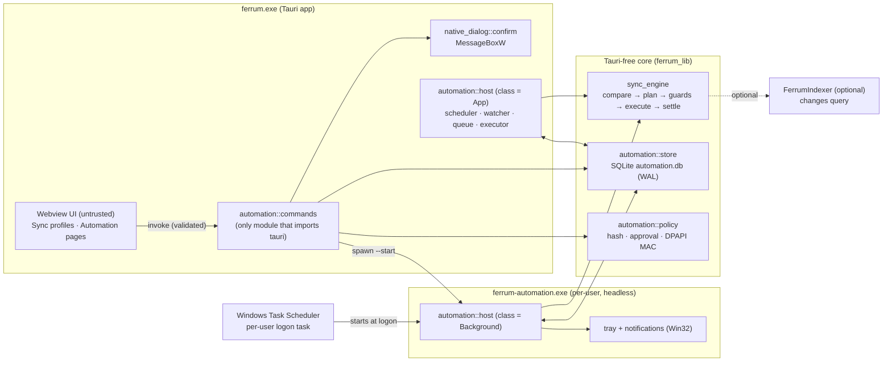
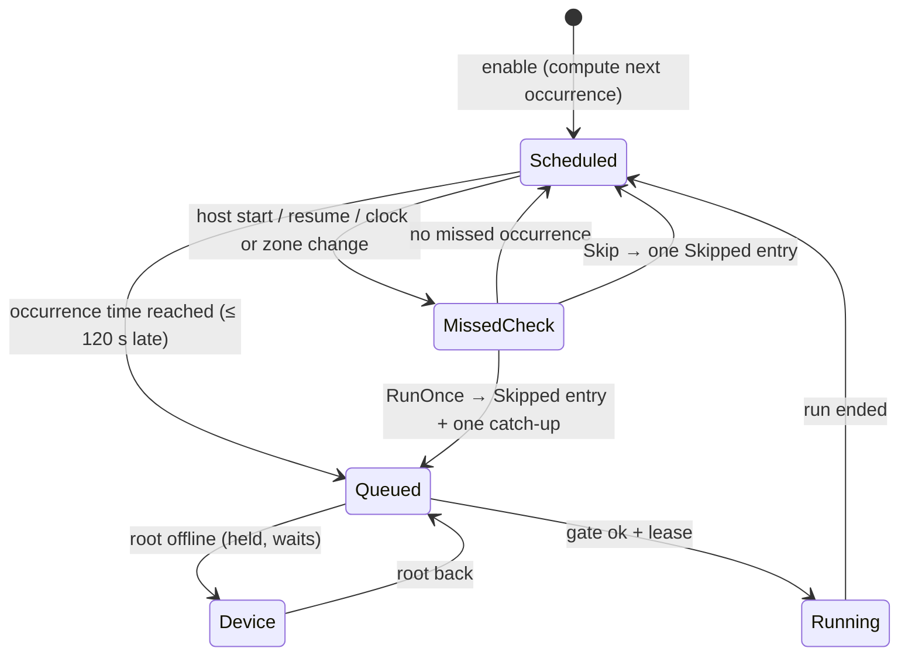
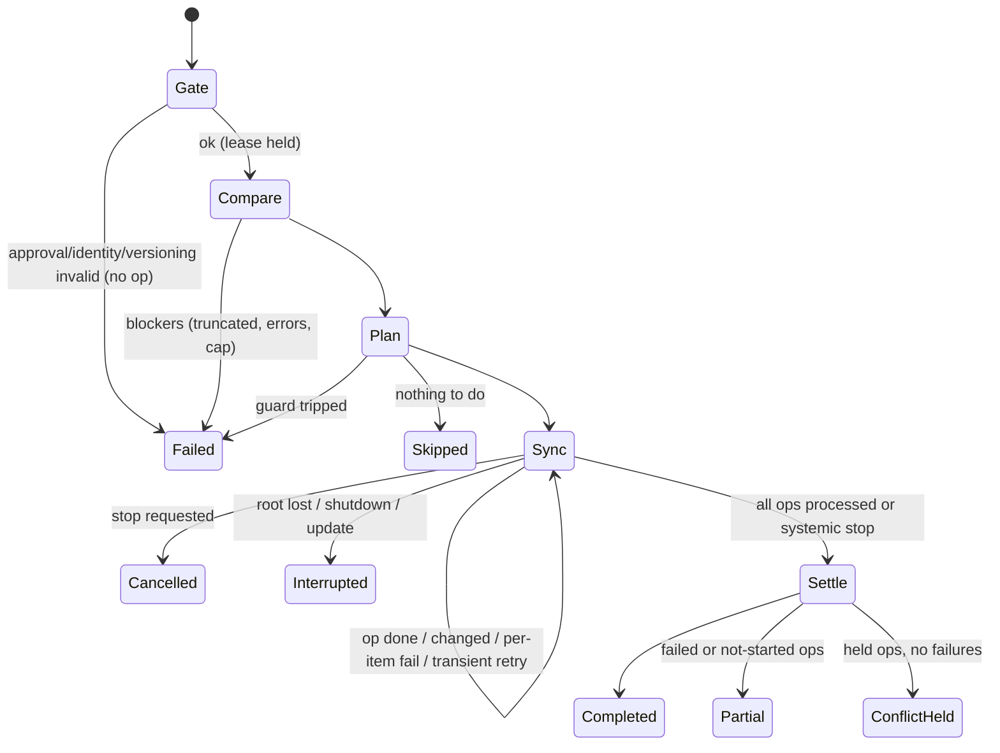

# Automation — Design

Status: **Draft for implementation** · Requirements: [requirements.md](requirements.md) · Work packages:
[tasks.md](tasks.md)

This document fixes the decisions an implementer must not make alone. Where it says MUST, deviating needs a design
change reviewed like any security change. Where it leaves a choice ("implementer's choice"), any option that keeps
the tests in §13 green is acceptable.

## 1. Facts from the current code (verified on `main`)

| Area                                   | Today                                                                                                                                                                                                                                                                                    | Consequence for Automation                                                                                                                                         |
| -------------------------------------- | ---------------------------------------------------------------------------------------------------------------------------------------------------------------------------------------------------------------------------------------------------------------------------------------- | ------------------------------------------------------------------------------------------------------------------------------------------------------------------ |
| Synchronize Dirs                       | Ad hoc between the two panes. Plan classification (`src/lib/syncPlan.ts`), execution orchestration (`src/lib/syncService.ts`: re-validate, batch `enqueueCopy`, deletes returned to the UI) and baseline reconciliation (`src/lib/syncBaseline.ts`) run **in the webview** (TypeScript). | A headless runner cannot run them. P0 ports plan, execution and reconciliation to Rust (`sync_engine`).                                                            |
| Named profiles                         | None. No revisions, no delete policy, no filters. `deleteExtras` is a panel toggle; deletes always go through the webview delete dialog (Recycle Bin default, D05).                                                                                                                      | Sync Profile is new (P0), including delete policies and filters.                                                                                                   |
| Versioning folder                      | None.                                                                                                                                                                                                                                                                                    | New (`sync_engine::versioning`).                                                                                                                                   |
| Compare                                | `compare.rs` walker over `TreeSource` (FER-472), read-only, cap 50 000 entries (`DIR_ENTRY_CAP`), depth 128, mtime tolerance 2 s, partial reports are never runnable.                                                                                                                    | Engine reuses the walker with a filter hook and a larger cap for profile runs (§5.3).                                                                              |
| Baselines                              | `sync_baseline.rs`: one JSON file per canonical root pair under the **roaming** app data dir (`sync-baselines`), atomic write, in-process `Mutex` only. Journal marks (FER-477b) optional.                                                                                               | Cross-process writers need a guard: only the holder of the root lease may save a pair's baseline (§5.7).                                                           |
| Incremental compare                    | `sync_incremental.rs` + FerrumIndexer `changes` (IPC v4), opt-in pref `syncJournalSkip`, read by Rust from `config.json`.                                                                                                                                                                | Reused as-is by the engine (§11).                                                                                                                                  |
| Watcher                                | `watch.rs`: `notify` 7, **non-recursive** pane watches, 500 ms debounce, emits `fs://changed`.                                                                                                                                                                                           | Automation needs its own recursive watcher with overflow and device handling (`automation::watcher`).                                                              |
| Operation queue                        | `ops.rs`: in-process, Tauri-free, one heavy job at a time (D14), not persisted (D42).                                                                                                                                                                                                    | Automation runs do **not** go through `OperationQueue`; the engine calls `copy_engine` directly and keeps its own durable queue (§4). D14 still holds per process. |
| Copy engine                            | `copy_engine.rs`: staged publish (`.{name}.ferrum-stage-<pid>-<n>`), overwrite backups (`.ferrum-backup-`), cancel token, per-source failures.                                                                                                                                           | Reused. Staging names are always excluded (SP-4.4).                                                                                                                |
| Native confirm                         | `hotlist/mod.rs`: `native_confirm` (`MessageBoxW`, `MB_DEFBUTTON2`, owner HWND), approvals bound to a SHA-256 key of the item identity, `approve_shown` re-checks after the dialog.                                                                                                      | Same pattern, extracted to a shared module (§10.3).                                                                                                                |
| Prefs                                  | `prefs.rs` / `save_prefs`: whole `Prefs` struct written to `config.json` (roaming config dir).                                                                                                                                                                                           | Automation data MUST NOT be in `Prefs` (SE-5).                                                                                                                     |
| Profile dirs                           | `profile.rs`: `FERRUM_PROFILE_DIR` test override for config, data, activity, webview.                                                                                                                                                                                                    | Add a `local` sub-dir for the automation store; the runner honours the same override (tests).                                                                      |
| Single instance / tray / notifications | None in the app. No `tauri-plugin-single-instance`, no tray, no notification plugin.                                                                                                                                                                                                     | In-app host election via store lease (§3.3); tray and notifications only in the runner, via Win32 (§9).                                                            |
| Bundled binaries                       | `ferrum-indexer.exe` and `ferrum-scan-helper.exe` are extra cargo bins bundled next to `ferrum.exe`; installer is **per-machine** (NSIS hooks + WiX fragment).                                                                                                                           | `ferrum-automation.exe` is a third bin; installer hooks gain stop/delete steps (§12).                                                                              |

## 2. Architecture



Pipeline per run: **trigger** (scheduler / watcher / run now / retry / catch-up) → **queue** (store) → **gate**
(§10.4) → **lease** (store) → `sync_engine::run` → **history** (store) → **events/notifications**.

Rules:

- Everything under `sync_engine` and `automation` except `automation::commands` is Tauri-free. A unit test greps
  these sources for `tauri::` and fails if found (the runner must not depend on a Tauri runtime).
- The webview never reads or writes the store, never computes status, never computes hashes. It renders DTOs.
- The app and the runner share **one** host implementation (`automation::host::Host<D: HostDeps>`); only the
  host class and the injected dependencies differ.

## 3. Process model

### 3.1 Who executes what

| Automation runtime                    | App open, runner alive                                    | App open, runner not alive                                              | App closed, user signed in                                           | User signed out / PC asleep                                           |
| ------------------------------------- | --------------------------------------------------------- | ----------------------------------------------------------------------- | -------------------------------------------------------------------- | --------------------------------------------------------------------- |
| While Ferrum is running               | App host executes                                         | App host executes                                                       | Nothing runs; missed-run policy / startup Checking on next app start | Nothing                                                               |
| Background                            | Runner executes; app shows live state and writes controls | App shows "Runner not running", starts the runner; **does not execute** | Runner executes                                                      | Nothing; missed-run policy / startup Checking at next logon or resume |
| Manual profile run / Synchronize Dirs | App executes (holds a manual lease)                       | same                                                                    | —                                                                    | —                                                                     |

Both hosts coordinate only through the store: queue rows, leases, controls, heartbeats, runtime state.

### 3.2 Writers

| Table (§4.3)                    | Written by                                                                                                      | Notes                                                   |
| ------------------------------- | --------------------------------------------------------------------------------------------------------------- | ------------------------------------------------------- |
| `profiles`, `profile_revisions` | App backend (commands)                                                                                          | Never the runner.                                       |
| `automations`, `approvals`      | App backend, **only after native confirmation** (approve, resume) or for safe-direction changes (pause, delete) | Never the runner.                                       |
| `automation_runtime`            | The host that owns the automation's runtime class; app backend on pause / profile change / resolve              | Row-level ownership by `host_class`.                    |
| `queue`                         | Owning host (triggers); app backend (run now, retry → for app class) and `controls` for background              | Background "Run now" is a control, the runner enqueues. |
| `leases`                        | Any host or manual sync; expiry cleanup by anyone                                                               | §3.4.                                                   |
| `runs`, `run_ops`, `events`     | The executing host; app backend for config events (approved, paused)                                            |                                                         |
| `controls`                      | App backend inserts; owning host marks handled                                                                  | §3.5.                                                   |
| `hosts`                         | Each process its own row                                                                                        | Heartbeat.                                              |
| `meta`                          | Migration only                                                                                                  |                                                         |

### 3.3 Host election

- **Runner:** a named mutex `Local\Ferrum.Automation.Runner.<profileKey>` (single instance per session) **and** a
  host lease row `hosts(kind='runner')` taken with `BEGIN IMMEDIATE`; if another live runner holds it, exit 0.
  `<profileKey>` = first 16 hex chars of SHA-256 of the canonical local data dir, so test profiles never collide
  with the real one.
- **In-app host:** the first app instance that acquires `hosts(kind='app')` hosts in-app automations; others run
  the same backend without a host loop (read, render, write controls). When the hosting instance exits, another
  open instance takes over within one heartbeat expiry.
- Liveness: a host row is live when `last_beat_ms` is ≤ 15 s old **and** the process `(pid, creation time)` still
  exists (`OpenProcess` + `GetProcessTimes`). Heartbeat every 5 s.

### 3.4 Leases (cross-process lock)

```text
leases(id TEXT PK, holder_kind TEXT, holder_pid INTEGER, holder_created INTEGER,
       run_id INTEGER NULL, roots TEXT /* JSON array of canonical roots */,
       acquired_ms INTEGER, beat_ms INTEGER)
```

- Acquire in one `BEGIN IMMEDIATE` transaction: delete leases whose holder is dead or whose `beat_ms` is > 30 s old;
  refuse if any remaining lease overlaps (RQ-2); insert.
- Holder heartbeats every 5 s while running; releases in `finally` (Drop guard).
- Overlap test on canonical strings (§5.8), component-wise, case-insensitive.
- Manual Synchronize Dirs (TypeScript flow) acquires a manual lease through `sync_lease_acquire` before
  re-validation and releases it after the baseline settle (or on cancel/close). If refused, the panel shows
  "These folders are in use by "<automation>" — wait or stop it" and runs nothing.
- P0.4 implementation notes: the lease id is a random 128-bit token (32 hex) that only the acquiring process
  receives; release and heartbeat also require the row's holder `(pid, creation time)` to match. The holder
  process is probed with `OpenProcess`/`GetProcessTimes`; a state that cannot be established counts as alive
  (fail closed) and expires by heartbeat instead. A heartbeat from the far future counts as stale. For manual
  leases the backend (not the webview, whose timers are throttled when hidden) heartbeats, but stops after 12 h.
  The `leases` table is part of schema v1, so P0.4 needs no schema bump.
  A lease id never leaves the process in any DTO other than the `sync_lease_acquire` answer to its
  requester (diagnostic UIs use `holder_kind` / `run_id` only). All manual leases of the process are released
  when the webview reloads its page. Known limit: a wall-clock jump forward of more than 30 s makes live
  leases look stale for at most one heartbeat (5 s); a step back is tolerated up to 5 minutes.
  Accepted limit (FER-549): navigating away in the middle of a copy releases the manual lease while the
  backend copy job already queued keeps running without a lease, so another holder may take the same
  folders meanwhile. No baseline is written in that case (the settle code died with the page, and
  `sync_baseline_save` needs a lease anyway), so the baseline stays consistent; only the copy itself is
  unprotected. The reload release runs off the UI thread and an acquire racing with it is discarded
  (registry epoch).
  Known edges (FER-549): the epoch only discards an acquire that began before the reload event. A
  `sync_lease_acquire` from the old page that the backend starts after the event reads the new epoch and
  registers a lease for the dead page, held until the next reload or the 12 h hold limit. Closing it
  needs a page generation carried from the Started event into the acquire call (not done: needs an
  IPC contract change). After a renderer crash (no ProcessFailed handler) leases stay registered and
  are heartbeated until the 12 h hold limit or Ferrum exits.
- `sync_baseline_save` (existing command) MUST refuse with `lease_required` unless the calling process holds a lease
  covering both roots (manual lease or run lease). This makes concurrent baseline writes impossible across
  processes.

### 3.5 App ↔ runner signalling (no command channel)

- Data path is the store only. There is no pipe, socket, COM server or window message that carries commands
  (SE-6).
- Wake-ups: two auto-reset named events in the session namespace:
  `Local\Ferrum.Automation.<profileKey>.ToRunner` (app → runner: "store changed, re-read") and
  `...ToApp` (runner → app: "state changed"). They carry no data; a forged signal only causes a re-read.
  Both sides also poll the store's `meta.change_seq` every 2 s as a fallback (MH-10).
- Controls table:

```text
controls(id INTEGER PK, automation_id TEXT NULL, run_id INTEGER NULL,
         action TEXT CHECK(action IN ('runNow','stop','pauseFinish','pauseStop',
                                      'recheck','retry','reload','restartRunner')),
         created_ms INTEGER, handled_ms INTEGER NULL, result TEXT NULL)
```

The runner treats controls as requests subject to the same gate as any trigger; `retry` still requires the gate,
`runNow` on a held automation is answered `held`. Controls older than 10 minutes are discarded unhandled.

## 4. Storage

### 4.1 Location

| Data                             | Path                                                                        | Why                                                                      |
| -------------------------------- | --------------------------------------------------------------------------- | ------------------------------------------------------------------------ |
| Automation store                 | `%LOCALAPPDATA%\dev.ferrum.app\automation\automation.db` (+ `-wal`, `-shm`) | Local, non-roaming (machine-bound paths, SQLite WAL needs a local disk). |
| Approval key                     | `%LOCALAPPDATA%\dev.ferrum.app\automation\approval.key`                     | DPAPI blob (§8.4).                                                       |
| Store backup during migration    | `automation.db.bak-v<from>`                                                 | LC-5; deleted after success.                                             |
| Sync baselines                   | unchanged: `<app data>\sync-baselines\`                                     | Shared with manual sync.                                                 |
| Prefs (read-only for the runner) | unchanged: `<app config>\config.json`                                       | Runner reads `syncJournalSkip` only.                                     |

With `FERRUM_PROFILE_DIR=<dir>`, the store is `<dir>\local\automation\` (new `profile::local_data_dir()` and
`profile::resolve_local_data_dir()` for code without an `AppHandle`). The runner resolves known folders with
`SHGetKnownFolderPath` and the identifier `dev.ferrum.app`, matching Tauri's resolution; a unit test asserts both
resolve to the same directory. Resolution uses the Known Folder API only: if it fails there is no fallback to the
temp dir or the environment, and the store is `store_unavailable` (the `LOCALAPPDATA` variable is used by tests solely
as a cross-check).

The store opens only if the `automation` directory and `automation.db` are not reparse points (fail closed with
`store_untrusted`).

### 4.2 Engine choice

SQLite through `rusqlite` (already in the dependency tree via `ferrum-activity-store`, `bundled`). Settings on
every connection: `journal_mode=WAL`, `synchronous=NORMAL`, `foreign_keys=ON`, `busy_timeout=5000`. All multi-row
changes in one transaction; lease and queue claims use `BEGIN IMMEDIATE`.

### 4.3 Schema

Schema version is `PRAGMA user_version` and mirrored in `meta('schema_version')`. Version 1 is created by P0,
version 2 by P1; later versions by later packages. All timestamps are Unix epoch **milliseconds** (D18). JSON
columns hold serde-serialized Rust types with `deny_unknown_fields` on read.

**v1 (P0):**

```sql
CREATE TABLE meta(key TEXT PRIMARY KEY, value TEXT NOT NULL);
-- keys: schema_version, created_by_version, min_writer_version, change_seq

CREATE TABLE profiles(
  id TEXT PRIMARY KEY,                -- UUID v4, lowercase
  name TEXT NOT NULL,                 -- 1..80
  name_key TEXT NOT NULL UNIQUE,      -- lowercase(name) for uniqueness
  revision INTEGER NOT NULL CHECK(revision >= 1),
  policy TEXT NOT NULL,               -- JSON ProfilePolicy (§4.4)
  policy_digest TEXT NOT NULL,        -- hex SHA-256 of canonical ProfilePolicy
  created_ms INTEGER NOT NULL,
  updated_ms INTEGER NOT NULL);

CREATE TABLE profile_revisions(
  profile_id TEXT NOT NULL REFERENCES profiles(id) ON DELETE CASCADE,
  revision INTEGER NOT NULL,
  policy TEXT NOT NULL,               -- JSON ProfilePolicy at that revision
  changes TEXT NOT NULL,              -- JSON [{field, from, to}] display values
  changed_ms INTEGER NOT NULL,
  PRIMARY KEY(profile_id, revision));

CREATE TABLE leases(...);             -- §3.4
CREATE TABLE hosts(
  kind TEXT PRIMARY KEY CHECK(kind IN ('app','runner')),
  pid INTEGER NOT NULL, created INTEGER NOT NULL,   -- process creation FILETIME
  version TEXT NOT NULL, schema_version INTEGER NOT NULL,
  session_id INTEGER NOT NULL, last_beat_ms INTEGER NOT NULL);
```

**v2 (P1):**

```sql
CREATE TABLE automations(
  id TEXT PRIMARY KEY,
  name TEXT NOT NULL,
  kind TEXT NOT NULL CHECK(kind IN ('schedule','watch')),
  profile_id TEXT NOT NULL REFERENCES profiles(id),
  policy TEXT NOT NULL,               -- JSON AutomationPolicy (§4.4)
  enabled INTEGER NOT NULL CHECK(enabled IN (0,1)),
  config_rev INTEGER NOT NULL,        -- +1 on every approved save
  created_ms INTEGER NOT NULL, updated_ms INTEGER NOT NULL);

CREATE TABLE approvals(
  automation_id TEXT PRIMARY KEY REFERENCES automations(id) ON DELETE CASCADE,
  hash_version INTEGER NOT NULL,
  policy_hash TEXT NOT NULL,          -- hex SHA-256 (§8.3)
  profile_id TEXT NOT NULL, profile_revision INTEGER NOT NULL,
  config_rev INTEGER NOT NULL,
  approved_ms INTEGER NOT NULL,
  mac TEXT NOT NULL);                 -- hex HMAC-SHA256 (§8.4)

CREATE TABLE automation_runtime(
  automation_id TEXT PRIMARY KEY REFERENCES automations(id) ON DELETE CASCADE,
  host_class TEXT NOT NULL CHECK(host_class IN ('app','background')),
  trigger_state TEXT NOT NULL,        -- watching|quiet|checking|device|recheck|unsupported|scheduled
  state_since_ms INTEGER NOT NULL,
  quiet_until_ms INTEGER, burst_started_ms INTEGER,
  pending_rerun INTEGER NOT NULL DEFAULT 0,
  check_reason TEXT,
  attention TEXT,                     -- JSON {kind: partial|conflict|failed, runId, text} or NULL
  schedule_cursor_ms INTEGER,         -- last instant evaluated for missed runs
  last_fired_occurrence_ms INTEGER,   -- SC-3.4
  next_occurrence_ms INTEGER,
  updated_ms INTEGER NOT NULL);

CREATE TABLE queue(
  id INTEGER PRIMARY KEY,
  automation_id TEXT NOT NULL REFERENCES automations(id) ON DELETE CASCADE,
  profile_id TEXT NOT NULL,
  host_class TEXT NOT NULL,
  trigger_kind TEXT NOT NULL,         -- schedule|watch|runNow|retry|catchUp|pendingRerun|available|recheck|startup
  trigger_text TEXT NOT NULL,         -- "Scheduled · 02:00 WIB"
  retry_of INTEGER,                   -- runs.id
  merged_count INTEGER NOT NULL DEFAULT 0,
  merged_reasons TEXT NOT NULL DEFAULT '[]',
  enqueued_ms INTEGER NOT NULL,
  UNIQUE(profile_id));                -- RQ-3.1: one queued entry per profile

CREATE TABLE runs(
  id INTEGER PRIMARY KEY,             -- shown as #1042; AUTOINCREMENT semantics (never reused)
  automation_id TEXT,                 -- NULL for manual profile runs
  automation_name TEXT,               -- snapshot
  profile_id TEXT NOT NULL, profile_revision INTEGER NOT NULL,
  policy_hash TEXT,
  host_class TEXT NOT NULL,           -- app|background|manual
  trigger_kind TEXT NOT NULL, trigger_text TEXT NOT NULL,
  merged_count INTEGER NOT NULL DEFAULT 0,
  retry_of INTEGER,
  started_ms INTEGER NOT NULL, ended_ms INTEGER,
  phase TEXT NOT NULL,                -- gate|compare|plan|sync|settle|done
  outcome TEXT,                       -- completed|partial|conflict|failed|cancelled|interrupted|skipped
  ops_total INTEGER NOT NULL DEFAULT 0,
  counts TEXT NOT NULL DEFAULT '{}',  -- {ok, failed, notStarted, held, skippedChanged}
  error_text TEXT, note TEXT,
  resolved_by INTEGER, resolved_text TEXT,
  recheck TEXT);                      -- JSON {state, remaining, text, atMs}

CREATE TABLE run_ops(
  run_id INTEGER NOT NULL REFERENCES runs(id) ON DELETE CASCADE,
  seq INTEGER NOT NULL,
  kind TEXT NOT NULL,                 -- copyNew|update|createFolder|copyFolder|delete|deleteToVersions|conflict
  side TEXT NOT NULL,                 -- target side: left|right
  rel_path TEXT NOT NULL,
  size INTEGER,                       -- bytes, NULL = unknown/folder
  status TEXT NOT NULL,               -- pending|inProgress|done|failed|notStarted|held|changed
  error_code TEXT, error_text TEXT,
  PRIMARY KEY(run_id, seq));

CREATE TABLE events(
  id INTEGER PRIMARY KEY,
  automation_id TEXT NOT NULL,
  at_ms INTEGER NOT NULL,
  kind TEXT NOT NULL CHECK(kind IN ('ok','warn','bad','mute','info')),
  text TEXT NOT NULL,                 -- ≤ 512 chars
  run_id INTEGER);

CREATE TABLE controls(...);           -- §3.5
CREATE INDEX events_by_auto ON events(automation_id, at_ms DESC);
CREATE INDEX runs_by_auto ON runs(automation_id, started_ms DESC);
```

**Additive column without a version bump (LC-5 note).** `queue.merged_from` (JSON array of the ids of OTHER
automations whose trigger was merged into the entry, default `'[]'`) was added by FER-524 after schema v2 shipped. It
is created on open with `ALTER TABLE queue ADD COLUMN ... DEFAULT '[]'` when `pragma_table_info` does not list it
(idempotent; the loser of a race for it accepts "duplicate column"), exactly like `baseline_gen`. The schema version
stays 2 and no migration backup is taken: the change is additive, an older binary that ignores the column reads and
writes the same table, and a store that never saw the column gets it at the first open of a binary that knows it.

Caps: `run_ops` stores the first 5 000 operations per run (MH-8), `events` the newest 200 per automation (pruned
on insert), `profile_revisions` the newest 50 per profile. A run row is never deleted while it is referenced by an
`attention` (OP-2).

### 4.4 Rust model (serde, camelCase, `deny_unknown_fields`)

```rust
pub struct ProfilePolicy {
    pub left: RootSpec,
    pub right: RootSpec,
    pub mode: SyncMode,
    pub delete_policy: DeletePolicy,
    pub compare: CompareMode,
    pub filters: Filters,
    pub guard: DeleteGuard,
}
pub struct RootSpec { pub path: String /* canonical display path */, pub identity: RootIdentity }
pub enum RootIdentity {
    Local { volume_serial: String /* hex u64 */, file_id: String /* hex 128-bit FILE_ID_INFO */,
            fs_name: String, drive: DriveKind /* fixed|removable */ },
    Network { unc_prefix: String /* \\host\share, lowercase */ },
}
pub enum Side { Left, Right }
pub enum SyncMode { OneWay { from: Side }, Mirror { from: Side }, TwoWay { propagate_deletes: bool } }
pub enum DeletePolicy { RecycleBin, Versioning { root: String }, Permanent }
pub enum CompareMode { SizeAndDate, Content }
pub struct Filters { pub include: Vec<String>, pub exclude: Vec<String> }
pub struct DeleteGuard { pub enabled: bool, pub max_count: u32, pub max_percent: u8 }

pub struct AutomationPolicy {
    pub trigger: Trigger,
    pub runtime: Runtime,            // App | Background
    pub retries: u8,                 // 0..=3
    pub conditions: Conditions,      // OP-1, default all false
}
pub enum Trigger { Schedule(ScheduleTrigger), Watch(WatchTrigger) }
pub struct ScheduleTrigger {
    pub freq: Freq,                  // Once { date: "YYYY-MM-DD" } | Daily | Weekly { days: Vec<u8> /* 0=Sun..6, sorted, unique */ }
    pub time: String,                // "HH:MM"
    pub tz: String,                  // IANA
    pub missed: MissedPolicy,        // Skip | RunOnce
}
pub struct WatchTrigger {
    pub watch_left: bool, pub watch_right: bool,
    pub on_changes: bool, pub on_available: bool,
    pub idle_secs: u32,              // 2..=3600
    pub max_wait_secs: u32,          // 60..=86400, default 900 (WA-1.4)
}
pub struct Conditions { pub skip_on_battery: bool, pub skip_on_metered: bool }
```

Validation lives in `TryFrom<Draft>` constructors; an invalid stored row is treated as **Needs review** (never
"fixed" silently).

### 4.5 Migrations and versions

- `automation::store::migrate(conn, app_version)` runs under `BEGIN EXCLUSIVE`, copies `automation.db` to
  `automation.db.bak-v<from>` first (after `wal_checkpoint(TRUNCATE)`), applies steps `from+1..=CURRENT`, sets
  `user_version`, deletes the backup on success. On failure the transaction rolls back and the backup stays.
- `meta.min_writer_version` = the oldest app version allowed to write (bumped when a migration is not
  backward-compatible). A process whose compiled `SCHEMA_VERSION` < stored `user_version` opens read-only, shows
  LC-3 behaviour and never writes.
- Every migration has a fixture test: a v(n-1) DB file built by the previous migration code → migrate → assert.

## 5. Sync engine (Rust)

New module tree `src-tauri/src/sync_engine/`. Pure planning code is separated from I/O so it can be tested with
fixtures.

### 5.1 API

```rust
pub struct EngineRequest<'a> {
    pub profile: &'a ProfilePolicy,
    pub baseline: BaselineSource,          // load from SyncBaselineStore by pair
    pub cancel: CancelToken,
    pub sink: &'a dyn EngineSink,          // phase, per-op status, counts (throttled ≤ 10/s)
    pub retries: u8,
    pub run_id: i64,
    pub dry_run: bool,                     // test run, recheck, checking
    pub entry_cap: usize,                  // §5.3
    pub incremental: bool,                 // §11
}
pub enum EngineOutcome {
    Completed { counts: Counts },
    Partial { counts: Counts, error: EngineError },
    ConflictHeld { counts: Counts },
    Failed { error: EngineError },          // before any op succeeded, or a guard refused
    Cancelled { counts: Counts },
    Interrupted { counts: Counts, why: InterruptReason },
    NothingToDo,
    DryRun { plan: PlanSummary, conflicts: u32, guard: GuardVerdict },
}
pub fn run(req: EngineRequest) -> EngineOutcome;
```

### 5.2 Plan (port of `syncPlan.ts`)

- `sync_engine::plan` ports `classifyDetailed`, `buildSyncPlan`, `applyDecisions` (not used unattended),
  `syncPlanBlockers`, `isPlanStale`, `planSummary` **one-to-one**, plus the SP-2.3 extension (two-way delete
  propagation), which is **only reachable when `propagate_deletes` is true** so existing fixtures keep passing.
- Mapping: `OneWay{from:Left}` = `direction: leftToRight, deleteExtras: false`; `Mirror{from:Left}` =
  `leftToRight, deleteExtras: true`; `TwoWay` = `both`.
- **Parity contract:** new fixtures `contract-fixtures/sync-plan/*.json` (`{report, options, baseline,
expected}`), read by a new vitest (`syncPlan.fixtures.test.ts`) against the TS implementation and by a Rust test
  against `sync_engine::plan`. Minimum fixture set: every `SyncAction`, every `SyncConflictReason`, folder entries,
  case collisions, untrusted baseline, swapped pair, partial report blockers, stale detection with and without
  content mode. Any later change to either implementation must update the fixtures and keep both green.
- `reconcileBaseline` and `provesFullSync` from `syncBaseline.ts` are ported the same way into
  `sync_engine::settle`, with fixtures `contract-fixtures/sync-baseline/*.json`.

### 5.3 Compare with filters and cap

- `compare.rs` gains `compare_dirs_filtered(left, right, opts, filter: &dyn EntryFilter, cap: usize)`; the existing
  `compare_dirs` calls it with a no-op filter and `DIR_ENTRY_CAP` (behaviour unchanged, existing tests untouched).
- `EntryFilter::visible(rel: &str, is_dir: bool) -> bool` is applied in the walker **before** an entry is recorded
  or descended, on both sides.
- Glob matcher: hand-written (no new dependency), case-insensitive with Unicode simple case folding (1:1 mapping only;
  special multi-char case mappings like Turkish `İ` or Kelvin sign `\u{212A}` are handled safely), `\` or `/` accepted
  as separators, `*`, `?`, `**`, trailing `\` or `/` = directories only. Trailing `\` or `/` does not anchor the pattern;
  anchoring is determined from the pattern without trailing separator (e.g. `node_modules\` matches `node_modules` folders
  at any depth, whereas `build\out\` is anchored because of the intermediate separator).
- Unanchored patterns (containing no separator other than an optional trailing directory marker) match basenames at any depth
  (gitignore style); patterns containing an internal separator match root-relative paths. An include matching a directory
  recursively includes all of its contents. Include list empty = include all.
- Built-in exclusions: copy staging (`.*.ferrum-stage-*`, `.*.ferrum-backup-*`), recycle bins (`$RECYCLE.BIN`), and
  System Volume Information (`System Volume Information`). `$RECYCLE.BIN` and System Volume Information are also
  safely over-excluded at the root level if present as the top component.
- Listing errors for items that are excluded by filter are ignored and not recorded as compare issues.
- Profile runs use `entry_cap = 200_000` (aligned with `sync_baseline::MAX_ENTRIES`). Exceeding it is a blocker:
  outcome Failed "Too many items (more than 200,000) — narrow the profile with filters." (open question Q6).

#### Profile plans never act on whole folders

Profile sync plans must never copy or delete folders wholesale, because doing so could inadvertently transfer or destroy files that were meant to be excluded by profile filters:

- In the profile path (`compare_dirs_filtered`), one-sided directories are always descended, regardless of whether filters or delete propagation are enabled. Children that pass filters are catalogued individually. All descended entries count toward the 200,000 cap.
- In profile mode, folder items never receive recursive copy or delete actions (`CopyToLeft`/`CopyToRight`/`DeleteLeft`/`DeleteRight`). Instead, explicit non-recursive actions are modeled:
  - **Folder creation (`CreateDirRight` / `CreateDirLeft`):** Non-recursive `mkdir`, while visible children are copied by their own individual file actions (`CopyToRight`/`CopyToLeft`).
  - **Folder deletion (`RemoveEmptyDirRight` / `RemoveEmptyDirLeft`):** Non-recursive `remove_dir`. For the P0.2 executor, if `remove_dir` fails because the directory is not empty (e.g. containing excluded or untracked files), this failure is treated as safely skipped (normal skip), NOT as an error that makes the run Partial.
  - **Deletion propagation (SP-2.3):** With `propagate_deletes: true`, one-sided folders with baseline are descended; individual unchanged files follow file propagation rules, while the folder itself becomes `RemoveEmptyDir*` (never recreated on the side where it was deleted). Without `propagate_deletes` (default), folders with baseline match TS parity (`conflict(deletedLeft/deletedRight)`).
- If an entry name exists on both sides but has differing filter visibility (e.g., folder on left vs file on right matching a directory-only filter `foo\`), it is hidden on both sides (fail-safe) and produces 0 sync actions.

### 5.4 Execution

1. **Fresh compare** (always; automation runs have no stale preview). Blockers (truncated, cancelled, errors) →
   Failed with `describeBlockers` text.
2. **Plan**; conflicts become `held` ops.
3. **Guards** (SP-5): delete count = ops with kind `delete`/`deleteToVersions`; percent denominator = compared
   entries on that side after filters. Guard trip → Failed before any op.
4. **Order:** create folders → copies and updates grouped by (target side, destination directory), batch ≤ 256
   items, `toRight` first (same as TS) → deletes last, and only if no copy batch failed (same rule as
   `runSyncPlan`).
5. **Just-in-time check** before each op: `symlink_metadata` of source and target vs plan facts (size, mtime ±2 s,
   kind, existence). Mismatch → op status `changed`, run continues, `pending_rerun = 1` for watch automations,
   a `recheck` queue entry otherwise.
6. **Copy** through `copy_engine::run_copy_controlled` with `ConflictPolicy::Overwrite` only for `update` ops
   (others `Skip`, which fails the op if the target appeared meanwhile). Per-source failures map to ops by source
   path.
7. **Delete** through `sync_engine::delete_policy` (§5.5). `RemoveEmptyDirRight`/`RemoveEmptyDirLeft` operations execute non-recursive `remove_dir`; if the folder is non-empty, the operation is skipped safely without error (treated as normal skip, not Partial).
8. **Cancel:** checked between ops and inside copy via `CancelToken`; staged publish means the file in progress is
   either fully published or not at all.
9. **Settle:** after any run that changed something, a verifying compare (same mode) + `settle::reconcile` → save
   the baseline **while still holding the lease** (§3.4). Settle failure does not change the outcome; it is logged
   as an event and the baseline stays as it was.

#### Execution contract for profile plans

1. **Parents are created no-follow.** `CopyTo*` and `CreateDir*` create any missing parent folders with handle-relative,
   no-follow primitives; a reparse point on the parent path is rejected (the item fails).
2. **A parent that is a file fails the item.** If a parent turns out to be a file, that item fails and nothing is overwritten.
3. **Order.** `CreateDir*` shallow to deep, before any file copy; `RemoveEmptyDir*` deep to shallow, last. A
   `RemoveEmptyDir*` that fails because the folder is not empty is skipped, not an error.
   `RemoveEmptyDir*` is also no-follow: a reparse point or junction is skipped, never removed or followed.
   `CreateDir*` on a folder that already exists succeeds; `RemoveEmptyDir*` on a folder that is already gone is skipped.
4. **Entry points.** P0.2 builds plans only with `build_profile_sync_plan` (the profile filter is a mandatory parameter; `&NoFilter` when there is no include list) and resolves
   conflicts only with `apply_decisions(.., PlanMode::Profile)`.
5. **Transit folders.** A folder that is visible only so the walker can reach deeper include matches (not selected by
   the include list, nor under a selected folder) always plans `Skip`: never `CreateDir*`, never `RemoveEmptyDir*`.
   Selected folders, and all folders when the include list is empty, behave as described above.
6. **Release-mode guard.** The executor must call `validate_profile_plan(&plan)` before running anything and refuse to
   run a plan that returns `Err` (a folder item with `CopyTo*`/`Delete*`). It runs on the FINAL plan, i.e. after `apply_decisions`. This check is always on; the
   `debug_assert!` inside the planner is only an extra.

### 5.5 Delete policies

| Policy       | Implementation                                                                                                                                                                                                                                                                                                                                                                                                                                                                                                                                                                                                                                                                                                                                                                                                      |
| ------------ | ------------------------------------------------------------------------------------------------------------------------------------------------------------------------------------------------------------------------------------------------------------------------------------------------------------------------------------------------------------------------------------------------------------------------------------------------------------------------------------------------------------------------------------------------------------------------------------------------------------------------------------------------------------------------------------------------------------------------------------------------------------------------------------------------------------------- |
| `RecycleBin` | Shell (`mutations::delete_to_trash`) one file at a time, called only after the file was opened by handle (a plain file that still matches the plan) and verified afterwards: the same object must report a path inside `\$Recycle.Bin\` and must not be delete-pending (a classic delete on FAT/exFAT keeps the name while the probe is open), otherwise the run stops as `recycle_bypassed`. Allowed only when the fresh identity says a drive-letter root on `DRIVE_FIXED` (the drive type is checked **at profile save and again at run time**; the bin settings only at run and preview), AND the volume's bin settings (`HKCU\...\Explorer\BitBucket`: `NukeOnDelete`, `MaxCapacity`, policy `NoRecycleFiles`) say it is usable; unreadable settings count as unusable. Otherwise the run fails before any op. |
| `Versioning` | `sync_engine::versioning::VersionStore::move_in`: the destination tree `<root>\<Left\|Right>\<yyyy-MM-dd HHmmss> #<run>\<rel parent>` is created with handle-relative, no-follow primitives (reparse points rejected). Same volume: rename by handle (`NtSetInformationFile(FileRenameInformation)` with the destination folder as `RootDirectory`, never replacing). Other volume: `copy_engine` into the held destination folder, size verified by handle, then the source is deleted by handle only if unchanged. Overwrites move the old target aside the same way, then copy.                                                                                                                                                                                                                                  |
| `Permanent`  | `archive_publish::delete_file_if`: the file is deleted through its own handle (no-follow, read-only attribute ignored) after its size and mtime were checked on that handle.                                                                                                                                                                                                                                                                                                                                                                                                                                                                                                                                                                                                                                        |

The versioning stamp is the run start time in the **system** time zone; the folder name never contains characters
invalid on FAT/exFAT.

### 5.6 Error classification

`sync_engine::errors::classify(io::Error | FsError) -> ErrorClass`:

| Class       | Win32 codes (examples)                                                                                                                                | Action                                                                    |
| ----------- | ----------------------------------------------------------------------------------------------------------------------------------------------------- | ------------------------------------------------------------------------- |
| Transient   | 32 SHARING_VIOLATION, 33 LOCK_VIOLATION, 54 NETWORK_BUSY, 59 UNEXP_NET_ERR, 64 NETNAME_DELETED, 121 SEM_TIMEOUT, 1231 NETWORK_UNREACHABLE (single op) | Retry up to `retries` with 2/10/30 s backoff after the JIT check (RQ-7.1) |
| Systemic    | 5 ACCESS_DENIED, 19 WRITE_PROTECT, 39 HANDLE_DISK_FULL, 112 DISK_FULL, 1326 LOGON_FAILURE, 1327–1331 account restrictions, 86 INVALID_PASSWORD        | Stop run (RQ-7.2)                                                         |
| Device lost | 21 NOT_READY, 55 DEV_NOT_EXIST, 1167 DEVICE_NOT_CONNECTED, 53 BAD_NETPATH / 3 PATH_NOT_FOUND **on a root**                                            | Stop after current file, Interrupted (RQ-7.4)                             |
| Per item    | 2 FILE_NOT_FOUND, 123 INVALID_NAME, 206 FILENAME_EXCED_RANGE, 223 FILE_TOO_LARGE, 1920 CANT_ACCESS_FILE                                               | Fail op, continue (RQ-7.3)                                                |
| Unknown     | anything else                                                                                                                                         | Per item; three unknown failures in a row → Systemic                      |

Access denied on a single file inside an otherwise writable tree is still Systemic (prototype: "permission errors
need you"); the note says which file.

### 5.7 Baseline ownership

Only the lease holder may save a pair's baseline. `SyncBaselineStore::save` gets a `&LeaseGuard` parameter in the
engine path; the Tauri command `sync_baseline_save` looks up a manual lease of the calling process for the pair.

### 5.8 Root canonicalization and identity

`sync_engine::roots::canonical(path)`:

1. `path_guard::check_str` rules (SP-1.4).
2. Mapped network drive (`GetDriveTypeW == DRIVE_REMOTE` for `X:\`) → `WNetGetUniversalNameW` → UNC.
3. Existing directory → `GetFinalPathNameByHandleW` (handle opened with `FILE_FLAG_BACKUP_SEMANTICS`, following
   junctions), strip `\\?\` / `\\?\UNC\`, uppercase the drive letter.
4. Identity: `GetVolumeInformationByHandleW` + `GetFileInformationByHandleEx(FileIdInfo)`; network roots record the
   lowercase `\\host\share` prefix plus the same ids when the share can be opened.
5. A folder that does not exist yet (a versioning root) is anchored at the real path of its nearest existing ancestor;
   `.`/`..`, empty, reserved-device and trailing-dot/space components are refused, as are control and format
   (bidi) characters anywhere.
6. Drive kind comes from the VOLUME: `GetVolumePathNameW` then `GetDriveTypeW` on that root. Recycle Bin is allowed
   only when the volume root is a drive-letter root (`X:\`) and the type is `DRIVE_FIXED`; a volume merely mounted
   into a folder never qualifies (fail closed, SP-3.1).

**Network roots, intentionally.** Every network I/O step (final path, folder open) has a 900 ms budget so two steps fit
the 2 s readiness budget, and at most 8 timed-out workers may linger (further work is refused at once). A root that
cannot be opened is accepted at save time with an UNVERIFIED identity (no ids) and is never Ready: readiness reasons
`rootOffline` (cannot be opened now; a slow NAS therefore reads as offline and the user can Recheck) and
`identityUnknown` (saved while offline, not verified since). **The P0.5 UI must map both reasons**, together with
`rootMissing | identityMismatch | recycleBinUnavailable | versioningRootInvalid | profileInvalid`.

Overlap = equal or component-prefix, compared with `CompareStringOrdinal(..., bIgnoreCase=TRUE)`.

### 5.9 P0.2 implementation notes (as built)

Decisions taken while building `sync_engine::execute`, so that reviewers and later packages do not have to
rediscover them:

- **Entry points.** `sync_engine::run(&EngineRequest) -> EngineReport` (`report.outcome` is the `EngineOutcome` of
  §5.1). The plan is built only through `build_profile_sync_plan(.., &ProfileFilter)` (the SAME `ProfileFilter`
  object the compare used; built-in excludes apply to every profile, with or without include/exclude lists) and
  `apply_decisions(.., PlanMode::Profile)`; `validate_profile_plan` runs on the final plan and a violation is
  `Failed("plan_invalid")` before any operation, in release builds too. `EngineEnv` (`sync_engine/env.rs`) holds every
  injection point: root probe, copier, Recycle Bin, versioning mover, sleeper, clock, root liveness, indexer
  `ChangesSource`, and observation hooks.
- **Operations and order.** Final plan items become operations: `CreateDir` (shallow to deep), copies/updates
  (`toRight` first, grouped by destination folder, batches of at most 256 files or 64 MiB; an overwrite always runs
  alone), file deletes, `RemoveEmptyDir` (deep to shallow). Deletes and folder removal are withheld (left
  `notStarted`) when any copy or update failed (`runSyncPlan` rule). Conflicts are `held` and never executed.
- **Folders.** Only a non-recursive `mkdir` through an opened parent handle and a non-recursive `remove_dir` through the
  folder's own handle (`archive_publish::remove_empty_dir`: reparse point = skipped, not empty = skipped, gone = skipped).
  Nothing in the engine calls `remove_dir_all`, `delete_permanent` or a path-based `remove_*` of ITS OWN. The only path-based deletions are the shell's Recycle Bin call (verified afterwards) and the `copy_engine`'s removal of its own backup of an overwritten file (a source test enforces the first part).
- **Parents and roots.** Parents are walked/created component by component from an opened root handle with
  `NtCreateFile` relative opens and `FILE_OPEN_REPARSE_POINT` (`sync_engine/nofollow.rs`). A name from a plan is checked
  per component first (`validate_portable_name`: no `..`, separators, device names, trailing dot/space, `:`).
  `archive_publish::open_root` checks the reparse attribute AFTER following the path, so the engine additionally proves
  that the opened root's final path equals the recorded canonical path (a junction anywhere on the way fails the run).
  Only sides that are written get a root handle (a read-only source keeps working).
- **Just-in-time (RQ-7.5).** Before every operation `symlink_metadata` of both sides is compared with the plan's facts
  (kind, size, mtime within 2 s, existence); a link at the entry itself is a skipped item
  (`link_unsupported`, links are not synchronized, see below). For `permanent` deletes and for every versioning move the size and
  mtime are checked AGAIN on the file's own handle, atomically with the delete/rename (`delete_file_if`,
  `rename_file_into_if`), so a file edited in the gap survives. The shell's Recycle Bin call has no such hook; there the
  check made right before is all there is. An in-place overwrite (`recycleBin`/`permanent`, SP-3.4) replaces the target
  when the copy commits, and FER-564 re-checks the TARGET at that moment (`sync_engine/commit_check.rs`,
  `archive_publish::replace_file_checked`): the target is opened with a share mode that denies other writers, deleters
  and renamers, its size, time and identity (volume serial + file index) are read from that handle and compared with
  the plan AND with the exact facts and identity the just-in-time check saw (a file swapped in by save-via-rename with
  the same size and time is another object and is caught; an edit in place that keeps size and time cannot be told
  without hashing and is out of scope), the old file is renamed aside by that handle, the staged file is published
  without replacing a name, and only then is the old file deleted. Folders and LINKS (symlink, junction, mount point:
  name-surrogate reparse tags) are refused; other reparse data (OneDrive/cloud placeholders, deduplicated files) is an
  ordinary file, exactly as in the plan and the just-in-time check. A changed, removed or swapped target is left as it
  is, the item is `changed` with the reason `target_changed` (another comparison is due) and the staged copy is
  discarded; a program that has the target open for writing makes the item fail as `sharing_violation` (retried like
  any transient error). If the publish of the staged file fails AND the old file cannot be renamed back (a newcomer took
  its name in those microseconds), the old file stays, intact, as `.<name>.ferrum-backup-*` next to the target; that is
  reported as `backup_left`, a systemic stop (the backup name goes to the log), not as an ordinary copy error. Paths are
  passed in the `\\?\` form so a target above MAX_PATH works as before. `ReplaceFileW` was not used: it works on paths,
  so nothing can be compared on the object it replaces.
- **Versioning.** `<root>\Left|Right\<yyyy-MM-dd HHmmss> #<run>\<rel>` (system time zone), folders created no-follow.
  Same volume: rename by handle (`NtSetInformationFile(FileRenameInformation)` with the destination folder handle as
  `RootDirectory`; the destination is never replaced). Another volume (`STATUS_NOT_SAME_DEVICE`): `copy_engine` into the
  held destination folder, size verified by handle, source deleted by handle only if it is unchanged since the copy
  started. Overwrites move the old target aside first, then copy without replacing. If that copy fails or is cancelled
  (FER-564), the old file is moved back by handle without replacing anything (`VersionStore::restore`; another volume:
  copied back, size verified, then the version is dropped); a name taken meanwhile is never replaced (the old version
  stays in the tree). A restore that fails is `restore_failed`, a systemic stop (the run ends Partial/Failed and the
  profile needs attention, also after a cancel): the old file is safe in the versions tree, the baseline entry is not
  advanced, so a two-way run finds target missing + source changed = a held conflict (`ModifyDelete`), never a delete,
  and a one-way or mirror run copies the file again. The versioning root is a folder
  (a file is refused), is created on first use and is covered by the run's lease.
- **Delete guard (SP-5, Q4).** Only FILE deletes count (removing an empty folder destroys nothing). A side trips when
  `deletes > max_count` AND `deletes * 100 > max_percent * files(side)`; the denominator is the FILE entries the
  compare saw on that side after filters (numerator and denominator agree). The empty-source rule (SP-5.2) is
  checked first and applies even when the guard is off. A tripped guard ends a run as `Failed("guard_tripped")`
  unless the request carries a `GuardAck`: a value only `automation::manual_run` can create, after the native
  dialog answered yes, valid for that plan fingerprint and that delete count. `empty_source` can never be acknowledged,
  and a source test keeps every other module (the future host) from creating a `GuardAck`.
- **Links and reparse data.** A name-surrogate reparse point (symlink, junction) is a link: its operation is `skipped`
  with `link_unsupported` (it holds no other operation back). Other reparse data (cloud placeholders such as OneDrive,
  deduplication) is an ordinary file or folder; the engine reads its metadata only and never opens it for content
  except when a copy needs the bytes.
- **Cost and stop.** One watcher thread per RUN feeds the run token (user cancel or lost lease); an operation costs no
  thread. Roots are pinned read-only and identity-verified (volume serial + folder id, on the handle) right after the
  gate and held until the run ends; written sides get a second, write-capable verified handle.
- **One run per profile, bounded previews.** A second manual run of a profile that is running is `in_use`; at most two
  previews compute at once.
- **Errors (§5.6).** `sync_engine/errors.rs`. Raw OS text never leaves the engine: a Win32 code is read from the text
  and mapped to a closed `Reason` vocabulary (`sharing_violation`, `access_denied`, `disk_full`, `link_in_path`, ...).
  Transient errors retry `retries` times (2/10/30 s) after a new just-in-time check; systemic errors stop the run;
  device loss, a root that vanished, or a lost lease end it as `Interrupted`; three unknown failures in a row stop it.
- **Lease and settle.** The request carries the run's `LeaseGuard`; it is checked before every operation and a watcher
  cancels an in-flight copy or move when it is lost (outcome `Interrupted(leaseLost)`). Settle (a fresh verifying compare
  in the profile's compare mode, `reconcile_baseline`, empty-folder entries dropped) saves through
  `sync_baseline::save_with_guard`, which requires THAT guard's own lease row to be alive and to cover both roots.
  `SyncBaselineStore::save`/`clear` are crate-private; integration tests save through a real lease.
- **Manual commands.** `sync_profile_preview` is a dry run; `sync_profile_run` needs the `previewId`, checks readiness,
  takes its own `Manual` lease, asks the native dialog for a `permanent` run that deletes (per run), then returns
  `{ runId }`; progress and the result arrive as `sync-profile://run` events. The engine refuses a plan whose names and
  actions differ from the previewed one (`plan_changed`). The run id of a manual run is process-unique and based on
  the clock (history assigns real ids from P1.2). Codes added to the closed set in use: `not_ready`, `canceled`.
- **Not in P0.2.** A stop control for a manual run (the token exists in `PreparedRun`), the manual-run UI (P0.5), queue,
  history, approval and host (P1.x).

## 6. Rust modules

### 6.1 New

| Module                                                                                                             | Responsibility                                                                                                            | Package                                                                                                                              |
| ------------------------------------------------------------------------------------------------------------------ | ------------------------------------------------------------------------------------------------------------------------- | ------------------------------------------------------------------------------------------------------------------------------------ |
| `sync_engine/mod.rs`                                                                                               | `run`, request/outcome types                                                                                              | P0.2                                                                                                                                 |
| `sync_engine/plan.rs`                                                                                              | Port of `syncPlan.ts` (+ SP-2.3)                                                                                          | P0.1                                                                                                                                 |
| `sync_engine/settle.rs`                                                                                            | Port of `reconcileBaseline` / `provesFullSync`                                                                            | P0.1                                                                                                                                 |
| `sync_engine/filters.rs`                                                                                           | Glob matcher, built-in excludes                                                                                           | P0.1                                                                                                                                 |
| `sync_engine/execute.rs`                                                                                           | Ordering, batching, JIT check, retries, cancel                                                                            | P0.2                                                                                                                                 |
| `sync_engine/delete_policy.rs`, `versioning.rs`                                                                    | §5.5                                                                                                                      | P0.2                                                                                                                                 |
| `sync_engine/errors.rs`                                                                                            | §5.6                                                                                                                      | P0.2                                                                                                                                 |
| `sync_engine/roots.rs`                                                                                             | §5.8, readiness probes                                                                                                    | P0.3                                                                                                                                 |
| `automation/store/{mod,migrate,profiles,automations,approvals,runtime,queue,leases,runs,events,controls,hosts}.rs` | SQLite store                                                                                                              | P0.3 (mod, migrate, profiles, hosts) / P0.4 (leases) / P1.1 (automations, approvals) / P1.2 (runtime, queue, runs, events, controls) |
| `automation/model.rs`                                                                                              | §4.4 types + validation                                                                                                   | P0.3 / P1.1                                                                                                                          |
| `automation/policy.rs`                                                                                             | Canonical policy, hash, MAC (§8)                                                                                          | P1.1                                                                                                                                 |
| `automation/dpapi.rs`                                                                                              | `CryptProtectData` / `CryptUnprotectData` wrapper                                                                         | P1.1                                                                                                                                 |
| `automation/confirm_text.rs`                                                                                       | Native prompt texts                                                                                                       | P0.3 / P1.1 / P3.2                                                                                                                   |
| `automation/status.rs`                                                                                             | Status precedence (§9.1) → `StatusDto`                                                                                    | P1.2                                                                                                                                 |
| `automation/host.rs`                                                                                               | Host loop: triggers → queue → gate → lease → engine → history; generic over `HostClass::{App, Background}` from the start | P1.3                                                                                                                                 |
| `automation/scheduler.rs`                                                                                          | Occurrences, DST, missed runs (uses `jiff`)                                                                               | P1.4                                                                                                                                 |
| `automation/watcher.rs`                                                                                            | Recursive watch, debounce state machine, overflow, device                                                                 | P2.1                                                                                                                                 |
| `automation/power.rs`                                                                                              | Hidden message window: `WM_POWERBROADCAST`, `WM_TIMECHANGE`, `WM_DEVICECHANGE`, session end                               | P1.4 (app) / P3.1 (runner)                                                                                                           |
| `automation/runtime/{task_scheduler,capability,launcher}.rs`                                                       | Logon task registration (COM), probe, start runner                                                                        | P3.2                                                                                                                                 |
| `automation/runner/{main,tray,notify,cli}.rs`                                                                      | Runner process                                                                                                            | P3.1 / P3.3                                                                                                                          |
| `automation/commands.rs`                                                                                           | All Tauri commands (§7); the only file importing `tauri`                                                                  | P0.3+                                                                                                                                |
| `native_dialog.rs`                                                                                                 | `confirm(owner_hwnd, caption, text) -> bool` extracted from hotlist; hotlist calls it                                     | P0.3                                                                                                                                 |
| `bin/ferrum-automation.rs`                                                                                         | Thin `main`: `harden_dll_search()` then `automation::runner::main()`                                                      | P3.1                                                                                                                                 |

### 6.2 Changed

| File                                                                                                                                   | Change                                                                                                                                                                                                                                                                                                                                                                              | Package                         |
| -------------------------------------------------------------------------------------------------------------------------------------- | ----------------------------------------------------------------------------------------------------------------------------------------------------------------------------------------------------------------------------------------------------------------------------------------------------------------------------------------------------------------------------------- | ------------------------------- |
| `compare.rs`                                                                                                                           | `compare_dirs_filtered` + `EntryFilter` + cap parameter                                                                                                                                                                                                                                                                                                                             | P0.1                            |
| `sync_baseline.rs`                                                                                                                     | save requires a lease in the engine path; command checks manual lease                                                                                                                                                                                                                                                                                                               | P0.4                            |
| `hotlist/mod.rs`                                                                                                                       | use `native_dialog::confirm` (behaviour unchanged, tests unchanged)                                                                                                                                                                                                                                                                                                                 | P0.3                            |
| `profile.rs`                                                                                                                           | `local_data_dir`, `resolve_local_data_dir`                                                                                                                                                                                                                                                                                                                                          | P0.3                            |
| `lib.rs`                                                                                                                               | register commands, manage `AutomationState`, start in-app host in `setup`                                                                                                                                                                                                                                                                                                           | each package, append-only block |
| `Cargo.toml`                                                                                                                           | `rusqlite` (same version and `bundled` feature as `ferrum-activity-store`, P0.3); `jiff` with its bundled time zone database (P1.4); `hmac` (RustCrypto, P1.1); windows-sys features `Win32_Security_Cryptography` (DPAPI), `Win32_NetworkManagement_WNet` (mapped drives), `Win32_System_Power`, `Win32_UI_Shell` (tray, already present) — Task Scheduler see the paragraph below | per package                     |
| `src/lib/syncService.ts`, `stores/syncFlow.svelte.ts`                                                                                  | acquire/release manual lease around execute + settle (§3.4)                                                                                                                                                                                                                                                                                                                         | P0.4                            |
| Installer: `windows/installer-hooks.nsh`, `windows/automation-runner.wxs` (new WiX fragment), `tauri.conf.json` (`componentGroupRefs`) | §12                                                                                                                                                                                                                                                                                                                                                                                 | P3.4                            |

New dependencies need the usual license check (`THIRD-PARTY-NOTICES.md`). The Task Scheduler COM interfaces are not
in `windows-sys`; the implementer either adds the `windows` crate (feature `Win32_System_TaskScheduler`,
`Win32_System_Com`) **only to the runtime module**, or drives `%SystemRoot%\System32\schtasks.exe /Create /XML`
with a generated XML file. Both are acceptable; the choice and its tests go in the P3.2 report.

### 6.3 Frontend

| File                                                                                                                                                                                                                                | Package                   |
| ----------------------------------------------------------------------------------------------------------------------------------------------------------------------------------------------------------------------------------- | ------------------------- |
| `src/lib/ipc/syncProfiles.ts`, `src/lib/ipc/automation.ts` (+ `.test.ts`)                                                                                                                                                           | P0.3 / P1.1               |
| `src/lib/stores/syncProfilesStore.svelte.ts`, `automationStore.svelte.ts`                                                                                                                                                           | P0.5 / P1.5               |
| `src/lib/components/automation/StatusChip.svelte`, `AutomationPage.svelte`, `AutomationList.svelte`, `AutomationEditor.svelte`, `AutomationReview.svelte`, `AutomationDetail.svelte`, `RunHistory.svelte`, `PauseStopDialog.svelte` | P1.5 / P1.6 / P2.2 / P4.1 |
| `src/lib/components/sync/SyncProfilesPage.svelte`, `SyncProfileEditor.svelte`, `ProfilePicker.svelte`                                                                                                                               | P0.5                      |
| `Sidebar.svelte` (new "Sync & Backup" section), `uiState.svelte.ts` (page routing like Activity)                                                                                                                                    | P0.5                      |
| `SettingsDialog.svelte` → new `AutomationSettingsSection.svelte` (runner state, retention)                                                                                                                                          | P3.2 / P4.2               |

Visual tokens and copy come from the prototype handoff (tokens table in the handoff README; they already match
Ferrum's violet palette). Components use the existing Ferrum primitives (Icon, segmented controls, dialogs, Toast).

## 7. IPC contract

Rules (as `docs/ipc.md`): camelCase, `u64` sizes, `i64` ms timestamps, optional fields omitted, errors
`{ code, message }` (no paths). All commands are `async` and do blocking work on `spawn_blocking`. Ids are lowercase
UUID v4 text and are validated with a strict regex before any lookup. String limits are checked before allocation
of derived data. Every command is covered by a contract fixture in `contract-fixtures/automation/`.

Error codes (closed set): `invalid_input`, `not_found`, `stale`, `in_use`, `needs_review`, `needs_attention`,
`not_ready`, `held`, `busy` (another native confirmation dialog is open: nothing is shown or saved), `lease_busy`, `lease_required`, `store_unavailable`, `store_untrusted`, `store_read_only`,
`runtime_unavailable`, `register_failed`, `canceled` (only where noted; most user cancels are a normal result).

### 7.1 Sync profiles (P0)

| Command                 | Input                                     | Output                                                                                             | Notes                                                                                                                                                           |
| ----------------------- | ----------------------------------------- | -------------------------------------------------------------------------------------------------- | --------------------------------------------------------------------------------------------------------------------------------------------------------------- |
| `sync_profile_list`     | —                                         | `ProfileSummaryDto[]` (id, name, revision, left, right, modeLabel, deleteLabel, readiness, usedBy) | readiness computed with ≤ 2 s budget per root; slower roots report `checking`                                                                                   |
| `sync_profile_get`      | `{id}`                                    | `ProfileDto` (policy + revisions changes list)                                                     |                                                                                                                                                                 |
| `sync_profile_validate` | `{draft}`                                 | `{errors: FieldError[], identities: {left?, right?}, kinds}`                                       | no side effects                                                                                                                                                 |
| `sync_profile_save`     | `{id?, expectedRevision?, draft}`         | `{status:'saved', profile} \| {status:'canceled'} \| {status:'stale'}`                             | native confirm when SE-1 applies; revision rule SP-6.1; marks dependants Needs review in the same transaction (SP-6.4)                                          |
| `sync_profile_delete`   | `{id, expectedRevision}`                  | `{status:'deleted'}`                                                                               | `in_use` if referenced                                                                                                                                          |
| `sync_profile_preview`  | `{id}`                                    | `{previewId, summary, conflicts, guard, blockers?}`                                                | read-only engine `dry_run`                                                                                                                                      |
| `sync_profile_run`      | `{id, previewId, confirmOverwrite: bool}` | `{runId}`                                                                                          | manual run under a manual lease; deletes confirmed by the existing webview dialog flow before this call except `permanent`, which the backend confirms natively |
| `sync_lease_acquire`    | `{left, right}`                           | `{leaseId} \| {status:'busy', holder}`                                                             | manual Synchronize Dirs                                                                                                                                         |
| `sync_lease_release`    | `{leaseId}`                               | `{}`                                                                                               | idempotent                                                                                                                                                      |

`draft` = `{name, left, right, mode: 'oneWay'|'mirror'|'twoWay', from?: 'left'|'right', propagateDeletes?,
deletePolicy: 'recycleBin'|'versioning'|'permanent', versioningRoot?, compare: 'sizeAndDate'|'content',
include: string[], exclude: string[], guard: {enabled, maxCount, maxPercent}}`.

### 7.2 Automations (P1+)

| Command                     | Input                                                            | Output                                                                                                     | Notes                                                                                                                   |
| --------------------------- | ---------------------------------------------------------------- | ---------------------------------------------------------------------------------------------------------- | ----------------------------------------------------------------------------------------------------------------------- |
| `automation_list`           | —                                                                | `AutomationRowDto[]` (status, runtime note, last run, flags `canRunNow`, `showReview`)                     | status from §9.1                                                                                                        |
| `automation_get`            | `{id}`                                                           | `AutomationDetailDto` (+ pipeline index, current run, waiting entries, recent runs, events page)           |                                                                                                                         |
| `automation_validate`       | `{draft}`                                                        | `{errors[], checks[], next[]}`                                                                             | next 3 occurrences for schedules                                                                                        |
| `automation_test`           | `{draft}`                                                        | `{testId, policyHash, steps: TestStep[], passed}`                                                          | read-only; records `(policyHash, passed, at)` in the in-memory `TestLedger`                                             |
| `automation_approve`        | `{id?, expectedConfigRev?, draft, testId}`                       | `{status:'approved', automation} \| {status:'canceled'} \| {status:'stale'}`                               | §8.2                                                                                                                    |
| `automation_set_enabled`    | `{id, enabled}`                                                  | `{status:'enabled'\|'paused'\|'canceled'}` or `needs_review`                                               | enable = native confirm + gate check; disable with a running run → `{status:'needsChoice'}` (UI shows the pause dialog) |
| `automation_pause`          | `{id, mode:'finish'\|'stop'}`                                    | `{status:'paused'}`                                                                                        | safe direction, no native confirm                                                                                       |
| `automation_delete`         | `{id}`                                                           | `{status:'deleted'}`                                                                                       | stops/cancels queued entries; webview confirm only                                                                      |
| `automation_run_now`        | `{id}`                                                           | `{result:'queued'\|'waiting'\|'merged'\|'device'\|'held'}`                                                 | background → control row                                                                                                |
| `automation_stop_run`       | `{runId}`                                                        | `{status:'stopping'}`                                                                                      |                                                                                                                         |
| `automation_recheck`        | `{runId}`                                                        | `{state:'running'}` (result via event)                                                                     | read-only engine                                                                                                        |
| `automation_retry`          | `{runId}`                                                        | `{result:'queued'\|'merged'}`                                                                              | only after a recheck with remaining > 0                                                                                 |
| `automation_history`        | `{filter:'all'\|'attention', automationId?, before?, limit≤100}` | `{runs: RunRowDto[], next?}`                                                                               |                                                                                                                         |
| `automation_run_ops`        | `{runId, offset, limit≤200}`                                     | `{ops: RunOpDto[], total}`                                                                                 |                                                                                                                         |
| `automation_events`         | `{id, before?, limit≤50}`                                        | `{events: EventDto[], next?}`                                                                              |                                                                                                                         |
| `automation_runtime_status` | —                                                                | `{background:'unavailable'\|'needsSetup'\|'ready', reason?, runner?:{alive, version, pid}, appHost: bool}` |                                                                                                                         |
| `automation_runtime_setup`  | —                                                                | `{status:'ready'\|'canceled'}` or `register_failed`                                                        | native confirm (RT-2.1)                                                                                                 |
| `automation_runtime_remove` | —                                                                | `{status:'removed'}`                                                                                       | pauses background automations                                                                                           |

Event `automation://changed` `{ids: string[], scope: 'list'|'detail'|'history'|'runtime'}` is emitted by the app
when its own writes or a `ToApp` signal / `change_seq` bump arrive; the UI re-fetches. Progress of a running run
arrives as `automation://progress` `{runId, phase, done, total, current?}` ≤ 10/s (app-hosted runs directly; runner
runs via store polling at 1 s while the detail page is open).

## 8. Approval

### 8.1 What is approved

The **policy**: `ProfilePolicy` (with identities) at a given profile revision + `AutomationPolicy` + ids. Not a
specific plan: each run computes a fresh plan within the approved policy, and the safety guards (SP-5) catch
surprising plans.

### 8.2 `automation_approve` sequence

```mermaid
sequenceDiagram
  participant W as Webview
  participant C as commands (app backend)
  participant S as store
  participant M as MessageBoxW
  W->>C: automation_approve(draft, testId)
  C->>C: validate draft → AutomationPolicy
  C->>S: load profile (current revision)
  C->>C: H = policy_hash(profile, policy)
  C->>C: TestLedger has (testId, H, passed, ≤15 min)? else stale
  C->>M: confirm(text built from validated data)
  M-->>C: OK / Cancel
  alt Cancel
    C-->>W: {status:'canceled'}
  else OK
    C->>S: BEGIN IMMEDIATE; reload profile + automation; H' = policy_hash(...)
    alt H' != H or configRev changed
      C-->>W: {status:'stale'} (rollback)
    else
      C->>S: upsert automation (config_rev+1, enabled=1), approval(H, mac), runtime row, event; COMMIT; signal ToRunner
      C-->>W: {status:'approved', automation}
    end
  end
```

Resume (`automation_set_enabled(true)`) follows the same shape without a test: it requires the stored approval to
verify (§8.5) **before** the dialog and again after it.

### 8.3 Policy hash

```text
H = SHA-256( len-prefixed("ferrum.automation.policy.v1")
           ‖ len-prefixed(automation_id)
           ‖ len-prefixed(profile_id) ‖ u64le(profile_revision)
           ‖ len-prefixed(serde_json::to_vec(PolicyV1 { profile: ProfilePolicy, automation: AutomationPolicy })) )
```

`len-prefixed(x)` = `u64le(len) ‖ x` (as `hotlist::store::command_key`). `PolicyV1` field order is fixed by the
struct definition; any change to `ProfilePolicy`, `AutomationPolicy` or their serialization MUST bump
`HASH_VERSION`. A golden-hash test pins `H` for a fixture policy so accidental serialization changes fail CI. The
automation name is not part of `H` (cosmetic), but every save still goes through the approval flow.

### 8.4 MAC and key

- Key: 32 random bytes (`getrandom`), stored as a DPAPI blob (`CryptProtectData`, current user, optional entropy
  `"ferrum.automation.approval.v1"`, `CRYPTPROTECT_UI_FORBIDDEN`) in `approval.key`.
- `mac = HMAC-SHA256(key, "ferrum.automation.approval.v1" ‖ H ‖ automation_id ‖ u64le(profile_revision) ‖
u64le(config_rev) ‖ u64le(approved_ms))`, constant-time compare on verify.
- Missing or undecryptable key → every approval fails verification → all automations Needs review (fail closed).
  The next approval creates a new key.
- Purpose: binds approvals to this Windows user on this machine (a restored or copied store needs re-approval) and
  makes store tampering by anything that cannot call DPAPI as the user detectable. It is **not** a defence against
  malware running as the user (out of scope, §10.1).

### 8.5 Verification (`policy::verify`)

Used by the gate (§10.4), `automation_list` (to show Needs review) and resume. Steps: approval row exists →
`hash_version` supported → recompute `H` from current rows → equals `policy_hash` → `profiles.revision ==
profile_revision` and `automations.config_rev == config_rev` → MAC verifies. Result `Valid | NeedsReview(reason)`,
where reason is one of `profileChanged{from,to}`, `policyChanged`, `notApproved`, `keyUnavailable`,
`unsupportedVersion`.

### 8.6 P1.1 implementation notes (as built)

- **MAC layout.** Every field of the MAC input is length-prefixed (or a fixed `u64le`), not
  concatenated bare, and the MAC also covers `hash_version` and `profile_id`. The exact layout is in
  the module comment of `automation/policy.rs` and `docs/ipc.md`.
- **`verify` order.** Approval row → hash version → profile id → **profile revision** → recomputed
  `H` → `config_rev` → MAC. The revision is compared before `H` so that a profile edit reports
  `profileChanged{from,to}` (the revision is inside `H`, so comparing `H` first would always say
  `policyChanged`). A MAC that does not verify under a usable key is `notApproved`: the approval
  does not authenticate on this machine for this user (tampered row, restored backup, key
  recreated after loss).
- **Test input.** `automation_test` takes `{ id?, draft }`: the policy hash covers the automation id,
  so an edit is tested under its own id and a NEW automation gets its id from the test answer
  (`automationId`). `automation_approve` takes the id of a new automation from the test ledger; the
  webview never chooses one. A test record is single-use and re-checked for the 15-minute window
  after the native confirmation.
- **Profile and automation baselines (FER-522 decision).** Runs of profiles and automations use a
  separate baseline store (`<automation dir>\baselines\`) whose files carry a MAC under a subkey of
  the approval key (`automation/profile_baseline.rs`, `sync_baseline::BaselineAuth`). A file
  without a valid MAC loads as `FirstRun { Untrusted }`, so no deletion is ever propagated from it;
  `verify_profile_baseline(store, pair)` tells the runner (P1.3) `Trusted | Absent | Untrusted |
RootsUnavailable` before it plans. The manual `sync_baseline_*` commands only hold the unsigned
  manual store. Each pair has a save counter in the store (`baseline_gen`); the file holds the
  counter it was written under (covered by the MAC) and loads only if it equals the current one, so
  a replayed older authentic file is `Untrusted`.
- **Approval key rules (rework 1).** Only an approval REPLACES the key; baseline signing may create it
  only when no key file exists at all (same lock, atomic create, same events). A key is replaced only when its blob was read in full and DPAPI refused it (`Unusable`), after
  the old blob was copied to `approval.key.bak`; an I/O error, sharing violation, reparse point or
  oversized file (`Unreadable`) never rotates it. Creation and replacement hold the
  `approval.key.lock` file lock across processes, and a created or replaced key writes a `warn`
  event on every automation. Secret buffers are zeroed (DPAPI output before `LocalFree`,
  `Zeroizing` copies, `ApprovalKey` on drop). The key and baseline folder are read through one
  handle opened with `FILE_FLAG_OPEN_REPARSE_POINT`.
- **Guard that cannot trip is OFF (rework 1).** The engine stops a run only when the deletes exceed
  BOTH the count and the percent of the side, and deletes never exceed 100 %, so `maxPercent` 100
  (or a zero count) is a guard that never fires. Validation refuses percent above 99;
  `DeleteGuard::effective()` treats such a stored guard as off for `confirm_needed` (SE-1) and for
  the approval dialog (warning and "Delete guard: off."). Every approval dialog shows the guard line.
- **`syncJournalSkip` (rework 1 finding).** The global preference (Settings, `save_prefs`, default
  off) lets a Content compare skip reading a file when the indexer journal proves its folder
  unchanged AND the signed baseline holds exactly the current size and mtime. It can only make a
  compare answer "same" for a pair that already matched on size and time, so it can leave a change
  unsynced; it cannot create a delete or an overwrite that the approved policy would not make
  (deletes come from presence against the baseline, which stays signed). The webview can switch it
  without a dialog, which is acceptable: it narrows what a run does and is not part of the hash.
- **Schema v2** creates every table of §4.3 and §3.5 at once (`automations`, `approvals`,
  `automation_runtime`, `queue`, `runs`, `run_ops`, `events`, `controls`, `baseline_gen`); P1.2/P1.3 add logic, not a
  schema step. `runs.id` is `AUTOINCREMENT` (never reused).
- **Not yet built (later packages):** `next` occurrences of a schedule and the existence check of the
  IANA zone (P1.4 owns the time zone data; P1.1 checks syntax), the background runner readiness
  (P3: a `background` automation cannot pass its test until then), the gate and run part of pause
  (P1.3).

## 9. State machines

### 9.1 Status precedence (`status::compute`)

```text
if verify != Valid                      -> review   "Needs review"            sub: reason (e.g. "Profile changed (rev 3 → 4) · held")
if runtime == Background && !runner_live-> warn     "Runner not running"      sub: "Background automations don't run until the runner starts"
if active run for this automation       -> running  "Comparing" | "Running d/n" sub: "Stopping after the current file" | "1 pending rerun after this" | trigger text
if queued entry for this automation     -> device "Waiting for device" (root offline) | queued "Queued" (sub: waits for <other> — same folders / Starting… / Waits for AC power)
if attention                            -> attention "Needs attention"    sub: "<text> · new runs held"
if !enabled                             -> paused   "Paused"              sub: "Not monitoring" | "No new runs"
schedule: device (root offline at next run) | scheduled "Scheduled" sub "Next Tue 29 Sep, 18:00 WIB" | "No upcoming run"
watch:    pending (pending && overlapping run active) | quiet | checking | device | recheck | unsupported | watching
          ("Another run is using these folders" | "Runs after 10 s without changes")
```

### 9.2 Watch trigger

```mermaid
stateDiagram-v2
  [*] --> Checking: enable / host start / resume from sleep
  Checking --> Watching: in sync
  Checking --> Queued: differences found
  Checking --> Device: root unavailable
  Watching --> Quiet: change event (not excluded, not self)
  Quiet --> Quiet: change event (reset idle; max wait not reached)
  Quiet --> Queued: idle elapsed OR max wait reached
  Watching --> Pending: event while overlapping lease active
  Quiet --> Pending: event while overlapping lease active
  Pending --> Checking: lease released (recompare)
  Queued --> Running: gate ok + lease
  Running --> Watching: run ended (pending=0)
  Running --> Checking: run ended (pending=1)
  Watching --> Device: root lost
  Quiet --> Device: root lost
  Device --> Checking: root back AND onAvailable
  Device --> Watching: root back AND !onAvailable
  Watching --> Recheck: overflow
  Quiet --> Recheck: overflow
  Recheck --> Checking: no overlapping run active
  Watching --> Unsupported: no watchable root
```



Notes: `Pending` is the `pending_rerun` flag, displayed only while an overlapping run is active (prototype).
Paused, Needs review and Needs attention freeze the machine: events are logged as "held (needs review / needs
attention)" and the state resets to Watching on pause or profile change.

### 9.3 Schedule trigger



Timer: the host computes the next occurrence (`jiff`, IANA zone) and waits with a timeout of `min(next - now,
60 s)`; it re-evaluates on `WM_TIMECHANGE`, `WM_SETTINGCHANGE("TimeZone")` and `PBT_APMRESUMEAUTOMATIC`. An
occurrence is fired only if `occurrence > last_fired_occurrence_ms`. DST: `jiff` `Zoned` resolution — gap →
skipped with SC-2.1 entry, fold → earlier instant.

### 9.4 Run



"Nothing to do" after a fresh comparison is recorded as Skipped "Fresh comparison found nothing to do" only for
pending reruns, retries and catch-ups; for an ordinary trigger it is Completed with 0 operations ("Already in sync ·
0 operations"), as in the prototype.

### 9.5 P1.2 implementation notes (as built)

- **`status::compute`** (`automation/status.rs`) is one pure function over a `StatusInput`; `read.rs` gathers the
  facts in one `with_read` snapshot. Sub-lines exist only where the spec gives a string (running, queued, attention,
  review, paused, quiet, pending, scheduled); chips without one (watching, checking, device, recheck, unsupported)
  have none. Paused reads "Not monitoring" for a watch and "No new runs" for a schedule.
- **Queued reason is derived, not stored:** `device` when the runtime row says so, "Waits for \"<run>\" - same
  folders" when an active run's profile roots overlap (`sync_engine::roots::overlap` on the stored canonical
  paths), otherwise "Starting...". The OP-1 reasons ("Waits for AC power") are in the pure function and are
  produced once the host evaluates conditions.
- **Queue merge** keeps the earlier entry's place and trigger. A `retry` upgrades an entry of the SAME automation
  and is refused (`Enqueued::Refused`) against another automation's entry, so the run that resolves a hold is
  never replaced by an unrelated one.
- **Attention is set by `runs::finish`** in the same batch that ends the run (Partial / Conflict / Failed of an
  automation run); an attention column that does not parse still reads as a hold (`failed`).
- **Events are ordered and paged by `id`** (insertion order), not `at_ms`: a clock that steps back cannot reorder
  the log or hide an entry from a page. Pruning keeps the newest 200 by `id`.
- **Controls** older than 10 minutes, or stamped more than 60 s ahead of the reader, are ignored and swept.
- **Queued chip is per automation** (`queue.automation_id`), as 9.1 says; the detail's `waiting` list is per
  profile (the one entry all automations of the profile share).
- **Attention survives approve and resume** (`reset_runtime` no longer clears it): only a resolved recheck or
  retry releases a hold (RQ-10.3/10.4).
- **For P1.3 (merged entries):** one entry per profile can carry triggers of another automation that was merged
  into it. When the entry is removed because its owner is paused, held (attention) or in review, the host must
  re-enqueue the triggers of the OTHER automations of that profile that are still enabled and verified, or the
  merge would silently drop them. `UNIQUE(profile_id)` rules out a separate entry, and merging into an entry
  whose owner is held cannot be refused without losing the trigger, so the re-enqueue is the host's job.
- **`canRunNow`** is false with "Runner not running" for a background automation while the runner is down. A
  store failure while verifying shows as "Approval key unavailable" (generic, still fail-closed).
- **No new index on `runs`:** pages order by `id`; the existing `runs_by_auto` index still narrows by automation
  and the table holds one row per run, so no v3 migration was added for it.
- **Not changed:** schema v2 (no migration step); `automation_runtime.next_occurrence_ms` stays empty until P1.4.
- **Additions to the P1.1 code:** `StoreError::Invalid`; `pause` also clears `pending_rerun` (RQ-8.2).

### 9.6 P1.3 implementation notes (as built)

- **Modules.** `automation/host.rs` (loop, election, controls, recovery) with `host/gate.rs` (the gate and its proof),
  `host/runner.rs` (queue walk, one run, recheck, settle), `host/request.rs` (what the commands and controls ask),
  `host/engine.rs` (the one door to the engine), `host/requeue.rs` (merged triggers), `host/prod.rs` (production deps).
  The host is generic over `HostDeps`; `HostClass::App` is wired by `lib.rs`, `HostClass::Background` is only
  constructed by tests until P3.1. A host executes only automations of its class.
- **The gate is a type.** `gate()` is the only function that can build a `GateOk` (private fields, no constructor, not
  `Clone`). `HostDeps::run_engine` and `engine::run_gated` take `&GateOk`, so every run path - triggers, Run now, retry,
  recheck, catch-up, pending rerun - reaches the engine only after `policy::verify` (design §10.4). Source tests keep the
  engine's request type out of every other host file and keep `GateOk {` out of every file but `gate.rs`; the same tests
  forbid `GuardAck` in the host (an unattended tripped guard fails the run). `verify` runs twice per gate: before the
  folder probes and the lease, and again after them, and the run is refused (`Changed`) if the approval, profile
  revision, configuration revision or hold moved in between. A recheck is gated too (`GateKind::Recheck`: read only, no
  lease, may look at a paused automation).
- **Refusals.** One reason per refusal, one event, never a file operation. Removed from the queue: paused, wrong runtime,
  needs review, attention hold, a failed delete-policy prerequisite (recorded as a Failed run). Kept: unmet condition,
  offline or swapped folder (status Waiting for device; identity mismatch waits too, per §10.4 step 7), busy folders,
  a store error. Kept entries are logged once per reason and tried again after 5 s.
- **Election** (`store/hosts.rs`). `claim` runs in one immediate transaction: an own row refreshes, a live foreign row
  (beat <= 15 s and process alive) refuses, anything else is taken over. The host beats every 5 s; a process that does not
  host asks every second. A host that lost its row stops starting runs but finishes the ones it has; their lease keeps the
  folders safe.
- **Recovery** (LC-6). On takeover a `Running` row of the host's class becomes Interrupted unless a LIVE lease still names
  it (a stalled host keeps its run), and dead leases are deleted at once.
- **Requests.** Run now and Retry queue directly for app automations (the toast needs the answer); background ones and
  Stop, Pause & stop and Recheck are `controls` rows answered by the host that owns the run (`mark_handled`). A Stop
  control stays pending until the run ends so the status line reads "Stopping after the current file". At most 10
  controls per second per target (T5).
- **Review items of P1.1** (`NTMS FER-524`): the approval key is replaced only after the user said Yes (Missing may still be
  created before the dialog); lease coverage is checked per holder kind (`manual` for the webview-driven baseline
  commands, the run's own kind for a run); the store refuses a nested call from inside one of its closures
  (`StoreError::Unavailable`, plus `store::inside_closure()` for the engine call) instead of deadlocking, and
  `KeyedAuth` documents the rule; `DeleteGuard::effective()` decides in the engine too; `baseline_gen` is created when a
  store is opened; key backups never overwrite an older `.bak` (timestamped); a lock file that cannot be created is
  logged with the OS error.
- **Engine.** A run asks `lease.covers()` at least every 2 s (P0.2 review P3-12) in addition to `is_lost()`, between
  operations and from the watcher that cancels a copy in flight.
- **Automatic runs were OFF in P1.3 (`host::UNATTENDED_RUNS_ENABLED = false`, decision after the P1.3 review); FER-525 (P1.4) turns them ON in its own, revertible commit. The text below describes the OFF behaviour, which tests still exercise per thread.**
  The engine runs only when the user asks at that moment (Run now, Retry). Parked, not run: pending reruns, the
  fresh comparison after a folder came back (`Available`), entries of triggers (schedule, watch, catch-up, startup),
  entries the gate kept waiting (device, conditions, busy folders) that would start later by themselves, and the
  move of merged triggers to a sibling (`requeue_siblings`). A parked entry stays in the queue, the status reads
  "Queued - Waiting - run it with Run now" and one event says so. A kept Run now is asked once; the user's next Run now
  (it merges into the entry and raises `merged_count`) asks again. A Run now that merges into another kind of entry
  makes it the user's request. **AUTO-P0.2c (P0.2 review P3-2 and P3-3) is REQUIRED before the switch is turned on.**
  Tests run both ways (`set_unattended_for_tests`); the shipped constant is pinned off by a test.
- **Review rework 1.** The gate reads its rows in one real read transaction and also recomputes the policy hash of the
  policies it puts in the proof (A1). A host that is closing or has lost the role starts nothing; a run registers as
  stopping when shutdown came in meanwhile (A2). The lease learns its run in the transaction that starts the run, and
  the run does not start if that fails (A3). Running rows are re-examined every 30 s, never within 30 s of their start,
  and never while a living holder (beat within 5 min) still claims them (A4). A queue entry belongs to one host class
  (a trigger of the other class is refused as busy), and an entry records which OTHER automations merged into it
  (`queue.merged_from`, an additive column created on open, schema version unchanged); only those are moved when the
  owner goes (A5). Stop and Recheck are routed by `run.host`, the host that ran the run (A6). Rate limits count per
  action, and "Pause & stop" is not limited at all, so a flood of Rechecks cannot hold a Stop back; a Recheck waits
  while any run works on overlapping folders (A7). RQ-10.2: "Retry remaining N" is shown only "after a Recheck that
  found N > 0 and the run was not a conflict", so a Conflict run never offers a retry (A7).
- **Conditions fail closed (A8).** Battery: unknown power status counts as battery. Metered: no detection exists, so a
  policy with `skipOnMetered` waits until OP-1 ships.
- **Guard (B-a).** A count of 0 is percent-only and still protects; `DeleteGuard::effective()` is false only for a
  disabled guard or a percent of 100 or more, in the engine, the dialog and `confirm_needed` alike.
- **Rework 2.** With automatic runs off, a user request (Run now / Retry) the gate answers with "keep" (device,
  conditions, busy folders, changed approval) is REMOVED from the queue with one event ("Waiting - run it with Run now"),
  so no later host (takeover, restart) can start it unasked; the in-memory "already asked" bookkeeping and its
  dependence on `merged_count` are gone. A user request older than 10 minutes is dropped with an event. Merged automatic
  triggers can never turn an entry into a user request (only a Run now / Retry merge does, by changing its kind).
  When an entry is removed and nobody takes over its merged triggers, each automation whose Run now was merged into it
  gets "Your Run now was not done - run it again". A Recheck or Retry control that expires unanswered is announced
  before it is swept. The recovery pass keeps the lease row of a living holder for 5 minutes; an acquirer still
  reclaims any lease stale for 30 s (design 3.4) and the stalled holder stops at its next cover check.
- **P3-2 and P3-3 (FER-564).** Both entry criteria of P0.2 review 2 are in: the commit-time re-check of an in-place
  overwrite and the restore of a versioned file whose replacement did not land (see Just-in-time and Versioning above).
  Until the scheduler (P1.4) and the watcher (P1.5) exist, the only trigger that can reach the engine is a user's Run now,
  a retry or a queued entry written by hand.
- **Known limits.** One run at a time per host. The per-operation list of a run is written when the run ends (the live
  view shows counts). Conditions: battery is read from Windows; a metered connection cannot be told yet, so a policy
  that skips metered connections waits (fail closed) until OP-1.

### 9.7 P1.4 implementation notes (as built)

- **Modules.** `automation/scheduler.rs` is pure (no store, no clock, no folder; every call takes `now_ms`),
  `automation/power.rs` is the hidden window, `host/schedule.rs` is the host's hook. Zones come from the bundled `jiff`
  database (`tzdb-bundle-always`), never from the machine.
- **Evaluation.** `Schedule::evaluate(state, now, policy)` looks at the slots in `(max(cursor, last_fired), now]`: an
  occurrence at most 120 s old (inclusive) fires, an older one is missed, a DST gap slot is a Skipped entry (SC-2.1), a
  fold is one slot at the first instant. `last_fired_occurrence_ms` also covers missed and gap slots, so nothing is
  handled twice whatever the clock does; the cursor is clamped to `now` and starts at `now` for a schedule that was just
  approved or resumed (`reset_runtime` clears it), so paused or pre-approval time is never "missed".
- **The hook only queues.** One pass (when the store changed, on host start, resume, clock or zone change, at the next
  occurrence, at least every 60 s) writes, in one transaction per pass: `Schedule` / `CatchUp` queue entries via
  `request::trigger_tx` (approval must VERIFY, no hold, enabled - same as Run now; user kinds are refused), Skipped history
  rows, and the schedule columns of the runtime row (compare-and-set against the rows it read). It never builds a
  `GateOk` and never calls the engine; every queued entry is gated again by `runner::start_cycle` (verify, folder probes,
  lease, delete-policy prerequisites). Source tests keep the gate, proof and engine names out of `schedule.rs` and
  every impure name out of `scheduler.rs`.
- **SC-4.** A device that is offline when an occurrence fires needs no special code: the entry waits in the queue, the gate
  answers "keep" (Waiting for device) and the run starts when the folder is back.
- **Condition (2) of the P1.3 review.** A trigger merged into a Run now never changes the entry's kind or `enqueued_ms`;
  only the user's own Run now / Retry restamps it (`enqueued_ms = now`). A user request older than 10 minutes, or stamped
  more than 60 s ahead of the clock (the clock moved back), is stale.
- **Validation.** `automation_validate` fills `next` (3 runs, label in the schedule zone) and enforces Once: date from
  today to today + 13 days in the schedule zone (`date_out_of_range`), a time that has passed (`time_passed`); an unknown
  zone is `tz_invalid` (also refused by the model at test and approve).
- **Known limit.** A system clock that jumps far forward and back leaves the occurrences after the stored mark suppressed
  until real time catches up (fail closed: no run, never an extra run).

## 10. Threat model and security controls

### 10.1 Assets, actors, trust boundaries

- **Assets:** the user's files in sync roots and the versioning root; the correctness of unattended deletes and
  overwrites; the user's authority to decide what runs unattended.
- **In scope adversaries:** (A1) a compromised webview (malicious content rendered by a preview, a bug in a
  frontend dependency) that can call any Tauri command with any arguments; (A2) another local user on the same PC;
  (A3) a stale or foreign store (copied profile, roaming, restored backup); (A4) external changes to roots (drive
  letter reassignment, junction planted in a versioning tree, network share replaced); (A5) a process squatting
  named objects in the user's session namespace at lower integrity.
- **Out of scope:** malware running as the same user at medium integrity (it can already modify the user's files
  and call DPAPI); administrators; physical attacks.
- **Boundaries:** webview ↔ app backend (Tauri IPC); app ↔ runner (store + data-less signals); host ↔ filesystem;
  host ↔ FerrumIndexer pipe (existing, authenticated).

### 10.2 Threats and controls

| #   | Threat                                                                                                                | Control                                                                                                                                                                                                 | Req              |
| --- | --------------------------------------------------------------------------------------------------------------------- | ------------------------------------------------------------------------------------------------------------------------------------------------------------------------------------------------------- | ---------------- |
| T1  | A1 creates/edits/approves/enables an automation that deletes or overwrites files unattended                           | Native confirmation built by the backend for every such action; no `confirmed` flag in any command; approval recomputed after the dialog                                                                | SE-1, SE-2, SE-3 |
| T2  | A1 edits the profile behind an approved automation (e.g. switches to permanent mirror)                                | Any policy change bumps the revision → hash mismatch → Needs review; permanent and guard-off need native confirm                                                                                        | SP-6, SE-4       |
| T3  | A1 writes automation data via `save_prefs` or generic file commands (create/rename/delete/copy into the app data dir) | Data lives only in `automation.db` under LocalAppData; `Prefs` has no automation fields; a direct file write still fails the MAC check (§8.4) and the store refuses reparse points                      | SE-5             |
| T4  | A1 tricks the user with a misleading UI before the native dialog                                                      | Dialog text comes from validated stored data, starts with warnings, names roots and delete policy; Cancel is default                                                                                    | SE-2             |
| T5  | A1 floods controls (run now, stop)                                                                                    | Controls are safe-direction or approval-bounded; rate limit 10 controls/s/automation; queue coalescing                                                                                                  | SE-6, RQ-3       |
| T6  | Runner accepts commands from a compromised webview                                                                    | Runner has no command endpoint; reads only the store; controls cannot create/approve/enable                                                                                                             | SE-6             |
| T7  | A3 store copied from another user/machine runs automations                                                            | DPAPI-keyed MAC fails → Needs review                                                                                                                                                                    | §8.4             |
| T8  | A4 drive letter now points to another disk; empty source                                                              | Root identity check; offline ≠ empty; empty-source and delete guards                                                                                                                                    | SP-5, SP-7, WA-5 |
| T9  | A4 junction planted inside the versioning tree redirects moves                                                        | Handle-relative no-follow creation (`archive_publish` primitives); reparse points rejected                                                                                                              | SE-9             |
| T10 | TOCTOU between plan and op                                                                                            | JIT re-stat before each op; staged copy publish                                                                                                                                                         | RQ-7.5           |
| T11 | A5 squats `Local\Ferrum.Automation.*` events/mutex                                                                    | Events carry no data; mutex squatting only prevents the runner from starting → visible "Runner not running"; host lease in the store is authoritative                                                   | §3.3, §3.5       |
| T12 | A2 reads another user's automation data                                                                               | Store under each user's LocalAppData (default user-only ACL); no shared machine-wide store                                                                                                              | SE-5             |
| T13 | Runner launched with crafted arguments                                                                                | Strict argv parser (`--scheduled`, `--start`, `--console --profile-dir <abs local dir>`, `--version`); anything else exit 2 before opening the store; `FERRUM_PROFILE_DIR` validated as in `profile.rs` | §12.1            |
| T14 | DLL planting next to the runner                                                                                       | `harden_dll_search()` first (as the indexer); runner lives next to `ferrum.exe`                                                                                                                         |                  |
| T15 | Notification/tray text injection (long or control chars from names/paths)                                             | Text built by the runner, bounded, control chars stripped                                                                                                                                               | NT-5             |
| T16 | Elevation creep                                                                                                       | No UAC, no service, `LUA` run level on the task, no writes outside profile + roots + versioning root                                                                                                    | SE-8             |
| T17 | Older binary corrupting a newer store                                                                                 | Schema/version gate; read-only for older writers                                                                                                                                                        | LC-3             |

### 10.3 Native confirmation module

`native_dialog::confirm(owner: isize, caption: &str, text: &str) -> bool` (moved from hotlist, same flags:
`MB_OKCANCEL | MB_ICONWARNING | MB_DEFBUTTON2 | MB_SETFOREGROUND`). Callers run it on `spawn_blocking`. The
production command wrappers take the confirmation as an injected `impl FnOnce(&Prompt) -> bool` in the Tauri-free
function (`approve_in(store, draft, test_ledger, confirm)`), exactly like `hotlist::run_command_in`, so tests drive
both answers without a window.

Prompt builders (`automation::confirm_text`) produce, in this order: warning lines (permanent delete; guard off;
two-way deletion propagation), action line ("Enable automation "Nightly photos to NAS"?"), profile line (name, rev,
`left → right`, mode, delete policy with versioning root), trigger line, runtime line (background: "Runs while
you're signed in, even when Ferrum is closed."), closing line ("Ferrum asks again whenever the profile's folders,
direction, delete policy, filters, trigger or runtime change."). Each part is shortened to 120 characters with an
ellipsis in the middle; total ≤ 2 000 characters.

| Action                                                                 | Native confirm                                       |
| ---------------------------------------------------------------------- | ---------------------------------------------------- |
| Approve new / edited automation                                        | **Yes**                                              |
| Resume (enable)                                                        | **Yes**                                              |
| Re-approve after profile change                                        | **Yes**                                              |
| Set up background runner                                               | **Yes**                                              |
| Save profile with `permanent` delete (new or changed to)               | **Yes**                                              |
| Turn delete guard off                                                  | **Yes**                                              |
| Manual profile run with `permanent` deletes                            | **Yes** (per run)                                    |
| Save other profile changes                                             | No (revision bump forces re-approval of automations) |
| Pause, stop, delete automation, remove runner, run now, recheck, retry | No (safe direction or within approval)               |

### 10.4 Gate (before every run)

`automation::host::gate(&ctx, automation_id) -> Result<GateOk, GateRefusal>`:

1. Load automation, approval, profile, runtime row in one read transaction.
2. `automation.enabled` (except a `retry` / `recheck` control, which may run while attention is set).
3. `policy.runtime` matches this host's class.
4. `policy::verify` == Valid.
5. Attention: refuse unless the queue entry is the resolving `retry`.
6. Conditions (OP-1) satisfied, else keep queued.
7. For each root: canonicalize, exists, identity equal → else `device` (keep queued).
8. Delete policy prerequisites: Recycle Bin drive type; versioning root valid, not overlapping either root, reachable.
9. Acquire lease for {left, right, versioning root}; busy → keep queued.

**The `enabled` flag is NOT an authorization.** Step 4 is mandatory on every run path (scheduled,
watch, catch-up, pending rerun, retry, recheck, run now): the gate calls `policy::verify` itself and
never infers "approved" from `automations.enabled`, the queue, the runtime row or an earlier
verdict. A test (`the_enabled_flag_is_not_an_authorization`) pins that `verify` ignores the flag.

Only after 1–9 may the engine touch files (and, while `UNATTENDED_RUNS_ENABLED` is off, only for a run the user asked for, §9.6). Every refusal writes one event and updates status; it never deletes the
queue entry except for Needs review (entry removed, SP-6.4).

## 11. FerrumIndexer synergy (FER-477)

- The engine passes `incremental = prefs.sync_journal_skip && compare == Content` into the existing
  `sync_incremental::prepare` path; marks are saved by `settle::reconcile` exactly as in manual sync.
- **Checking shortcut (P2.3, SHOULD):** for a watch automation whose profile has a baseline with journal marks on
  both sides, Checking first asks the indexer `changes` for both roots since the marks. If both answer `complete`
  and no changed directory lies under the roots (after filters), Checking completes as "in sync (journal: no
  changes since the last verified run)" without walking. Any other answer → ordinary comparison. Marks older than
  `MARKS_MAX_AGE_MS` (7 days) are not used.
- The indexer is never polled on a timer for change detection (WA-2.3: no polling).
- UNC roots and volumes without a journal always use the ordinary comparison.

## 12. Runner process and lifecycle

### 12.1 Binary

`ferrum-automation.exe`, `windows_subsystem = "windows"`, bundled next to `ferrum.exe` like the other bins.

```text
ferrum-automation.exe --scheduled                      started by the logon task
ferrum-automation.exe --start                          started by Ferrum (setup, enable, version restart)
ferrum-automation.exe --console --profile-dir <dir>    dev/test: no tray, logs to stderr, FERRUM_PROFILE_DIR semantics
ferrum-automation.exe --version
```

Startup order: `harden_dll_search` → parse argv → `profile::init` → single-instance mutex → open store (read-only
if older, exit 5) → host lease → heartbeat thread → hidden message window (tray, power, time, device, session end,
`TaskbarCreated`) → `Host::run(Background)`.

Exit rules: idle 10 minutes with no enabled background automation (RT-3.4); `restartRunner` control when idle;
`WM_QUERYENDSESSION`/`WM_ENDSESSION`/`WM_CLOSE` → stop runs (Interrupted) within 10 s; Ferrum missing next to the
runner → unregister own task (best effort) and exit (LC-1).

### 12.2 Logon task

- Name: `Ferrum Automation Runner (<user SID>)` in the root task folder (a per-user name avoids collisions between
  users; see open question Q1 for the fallback).
- Principal: `UserId = <current user SID>`, `LogonType = InteractiveToken`, `RunLevel = LeastPrivilege`.
- Trigger: `LogonTrigger` with `UserId = <current user SID>`, delay 30 s.
- Settings: `MultipleInstancesPolicy = IgnoreNew`, `ExecutionTimeLimit = PT0S`, `DisallowStartIfOnBatteries =
false`, `StopIfGoingOnBatteries = false`, `WakeToRun = false`, `StartWhenAvailable = false`, `RestartOnFailure`
  3 × 1 min, `Hidden = false`.
- Action: `"<dir of running ferrum.exe>\ferrum-automation.exe" --scheduled`.
- Capability probe reads the task back and compares principal, trigger, action path and enabled flag; any drift →
  Needs setup.

### 12.3 Installer

| Step                          | NSIS (`installer-hooks.nsh`)                                                                                                                                                                                                                                                                           | MSI (`automation-runner.wxs`)                                       |
| ----------------------------- | ------------------------------------------------------------------------------------------------------------------------------------------------------------------------------------------------------------------------------------------------------------------------------------------------------ | ------------------------------------------------------------------- |
| Before install/upgrade        | `"$SYSDIR\taskkill.exe" /IM ferrum-automation.exe` (graceful), wait ≤ 15 s, then `/F`                                                                                                                                                                                                                  | Same commands via `WixQuietExec64`, deferred, before `InstallFiles` |
| Uninstall                     | stop as above; delete every task whose name starts with `Ferrum Automation Runner (` using `"$SYSDIR\WindowsPowerShell\v1.0\powershell.exe" -NoProfile -NonInteractive -Command "Get-ScheduledTask -TaskPath '\' -TaskName 'Ferrum Automation Runner (*' \| Unregister-ScheduledTask -Confirm:$false"` | Same, deferred, `Impersonate="no"`                                  |
| "Delete the application data" | also removes the uninstalling user's `%LOCALAPPDATA%\dev.ferrum.app\automation`                                                                                                                                                                                                                        | `FERRUMPURGEAUTOMATION=1` same                                      |

Executables run by the installer come only from `System32` (same rule as the indexer hooks). A failing step never
aborts install or uninstall. Runners started again by a still-registered task after a failed uninstall exit by the
LC-1 self-check.

### 12.4 Version skew

| Situation                                              | Behaviour                                                                                        |
| ------------------------------------------------------ | ------------------------------------------------------------------------------------------------ |
| App newer than running runner                          | App inserts `restartRunner`; runner exits when idle; app starts `--start` from its own directory |
| Runner newer than app (app not restarted after update) | App sees store `user_version` > its schema → read-only + "Ferrum was updated — restart Ferrum"   |
| Same schema, different patch versions                  | Allowed; heartbeats show both versions in Settings                                               |
| Store schema newer than runner                         | Runner exits 5 without writing; event recorded by the app later                                  |

## 13. Test strategy

Principles: every requirement ID in the package's acceptance list has at least one test that names it in the test
name or a comment. No test needs administrator rights, a real Task Scheduler registration, a real logon, a real
sleep, a real network share or a real time-zone change.

### 13.1 Injection points

```rust
pub trait HostDeps: Send + Sync {
    fn clock(&self) -> &dyn Clock;                 // now_ms, monotonic, sleep_until with wake channel
    fn watchers(&self) -> &dyn WatcherFactory;     // real: notify RecommendedWatcher; fake: scripted events/overflow/vanish
    fn volumes(&self) -> &dyn VolumeProbe;         // availability + identity; fake toggles devices
    fn power(&self) -> &dyn PowerProbe;            // AC/battery, metered
    fn notifier(&self) -> &dyn Notifier;           // runner only; fake records
    fn launcher(&self) -> &dyn RunnerLauncher;     // app only; fake records
    fn engine(&self) -> &dyn Engine;               // real sync_engine or scripted outcomes
}
pub trait TaskRegistrar { fn register(&self, spec: &TaskSpec) -> Result<()>; fn query(&self) -> Result<Option<TaskSpec>>; fn remove(&self) -> Result<()>; }
pub trait Confirm = FnOnce(&Prompt) -> bool;
```

### 13.2 Layers

| Layer                     | What                                                                                                                                                                                                                                                                                                                                                       | How                                                                                                                                                                                  |
| ------------------------- | ---------------------------------------------------------------------------------------------------------------------------------------------------------------------------------------------------------------------------------------------------------------------------------------------------------------------------------------------------------- | ------------------------------------------------------------------------------------------------------------------------------------------------------------------------------------ |
| Pure Rust                 | plan/settle parity, filters, policy hash (golden), MAC, status precedence, scheduler occurrences/DST/missed, watch state machine, error classification, prompt texts                                                                                                                                                                                       | `cargo test --lib`; contract fixtures shared with vitest; fake clock with `Europe/Amsterdam` and `America/New_York` DST dates, `Asia/Jakarta`                                        |
| Store                     | migrations v0→v1→v2 (fixtures), leases (dead holder, expiry, overlap), queue coalescing, caps/pruning, read-only for older schema, reparse-point refusal                                                                                                                                                                                                   | temp dirs, two `rusqlite` connections in two threads                                                                                                                                 |
| Engine I/O                | execution on temp trees: copy/update/delete under each policy, versioning layout, junction planted under versioning root (skips when junction creation is unavailable), JIT change detection, cancel mid-run, transient retry with a fake erroring copier, device loss (folder renamed away), guard trips                                                  | temp dirs; `tempfile`                                                                                                                                                                |
| Host (in-process)         | full trigger → queue → gate → lease → engine → history flows with fakes; all prototype fixtures: burst t=0/t=6 idle 10 → one run at t=16; events during run → one pending rerun; overflow → recheck; device off/on; missed run skip / once; paused automation drops queue; profile change → Needs review; partial → attention → recheck → retry → resolved | `Host` with `FakeDeps`, virtual time                                                                                                                                                 |
| Cross-process             | two hosts (app class and background class) on one store in two OS processes: lease exclusion on overlapping roots, controls handled by the right host, heartbeat expiry after kill, crash mid-run → Interrupted on restart                                                                                                                                 | spawn `ferrum-automation.exe --console --profile-dir <tmp>` from an integration test (`tests/automation_runner.rs`); the second host is the test process. DPAPI works without admin. |
| Commands                  | validation of every input; approval with confirm true/false; stale after concurrent change; no `confirmed` input accepted; profile save triggers Needs review                                                                                                                                                                                              | Tauri-free `*_in` functions with injected `Confirm`                                                                                                                                  |
| Runtime (real OS, opt-in) | register/query/remove a logon task under a unique test name as the current non-admin user                                                                                                                                                                                                                                                                  | `#[ignore]` test run manually; plus §13.3 checklist                                                                                                                                  |
| Frontend                  | stores and IPC wrappers; StatusChip renders 18 kinds with icon + label; editor validation; review flow (test → approve enabled only after pass); Pause/Stop dialogs                                                                                                                                                                                        | vitest with mocked IPC                                                                                                                                                               |
| E2E UI                    | list, editor (schedule/watch), review & approve, detail, history, dialogs, sync profile editor; light/dark                                                                                                                                                                                                                                                 | Playwright with mock IPC (existing pattern), `--workers=2`                                                                                                                           |

Fake engine scripts the prototype outcomes (`completed`, `partial` with disk full at op 5, `conflict` at op 3) so UI
and host tests reproduce the prototype screens deterministically.

### 13.3 Manual verification (owner, standard user account)

1. As a non-admin user: Settings → Automation → Set up runner… → native dialog → OK → Task Scheduler shows the task
   for this user only; no UAC prompt appeared.
2. Background watch automation on `D:\Test\A → E:\Test\B` (USB drive). Close Ferrum. Edit files → after idle delay
   the files appear on E:; tray shows Running then Idle.
3. Unplug E: during a run → history shows Interrupted; replug → Checking → run only if differences.
4. Force a permission error on the target → notification "needs attention"; clicking it opens Ferrum on the run.
5. Sign out during a run → after sign-in, run shows Interrupted, Checking runs once.
6. Sleep the PC across a scheduled time with policy Skip / Run once → one Skipped entry / one catch-up.
7. Install a newer build while the runner is running → runner stops, history shows Interrupted, runner restarts.
8. Uninstall → task gone for every user that had one; no `ferrum-automation.exe` running.
9. Copy `automation.db` to another Windows user → all automations show Needs review.
10. Recycle Bin limits: on a test volume set the bin size to its minimum, then run a mirror profile with `recycleBin` that deletes a file larger than the bin. Note whether a dialog appears or the file is deleted silently; the expected result is the run stopping as `recycle_bypassed` with at most that one file lost. Also set "Don't move files to the Recycle Bin" on the volume and confirm the profile is refused as not ready.
11. OneDrive Files On-Demand: put a file that exists only in the cloud (not downloaded) on the target side of a mirror profile with a versioning folder, run it, and open the copy under the versioning folder: it must have its real content (the engine copies placeholders instead of renaming the stub).

## 14. Owner decisions

**Status: decided (2026-10-13).** The owner accepted every default below, so the "Decision" column is binding for implementation. Q1 still depends on the P3.0 spike result, as stated.

| #   | Question                                                                                                                                                                                        | Decision                                                                                                                                                                                                                                                                                                                                                                                     | Affects          |
| --- | ----------------------------------------------------------------------------------------------------------------------------------------------------------------------------------------------- | -------------------------------------------------------------------------------------------------------------------------------------------------------------------------------------------------------------------------------------------------------------------------------------------------------------------------------------------------------------------------------------------- | ---------------- |
| Q1  | If Windows refuses a per-user **logon** task without admin on some editions/policies, may the runner fall back to a per-user `HKCU\…\Run` entry (no restart-on-failure, no battery conditions)? | Yes, fallback allowed, shown as "Starts at sign-in (Run key)" in Settings; P3.0 spike decides whether it is needed at all                                                                                                                                                                                                                                                                    | P3.0, P3.2, P3.4 |
| Q2  | Watching **network shares**: keep Unsupported (prototype), or offer best-effort SMB change notifications with an explicit "may miss changes" label?                                             | Unsupported in v1                                                                                                                                                                                                                                                                                                                                                                            | P2.1             |
| Q3  | **Max wait** for folders that never go quiet (WA-1.4): accept the addition and the 15-minute default?                                                                                           | Yes, 15 min                                                                                                                                                                                                                                                                                                                                                                                  | P2.1             |
| Q4  | **Delete safety guard** defaults (> 50 items and > 20 %), and should the guard also apply to manual profile runs?                                                                               | Defaults as stated. **Revised 2026-10-14 (option A):** a manual run that trips the guard proceeds ONLY through a native per-run confirmation that states the number and percent of deletes (merged with the permanent-delete prompt into one dialog), bound to the previewed plan; no flag from the webview; an empty source (SP-5.2) is never run; automation runs can never lift the guard | P0.2, P0.5       |
| Q5  | **Two-way deletion propagation** (SP-2.3) in v1, or two-way never deletes (current manual behaviour)?                                                                                           | Included, off by default                                                                                                                                                                                                                                                                                                                                                                     | P0.1             |
| Q6  | Profile-run **entry cap** 200 000: enough, or raise (memory ~ 300 B/entry during a run)?                                                                                                        | 200 000                                                                                                                                                                                                                                                                                                                                                                                      | P0.1             |
| Q7  | **Versioning** also keeps overwritten files (spec: yes). Is versioning retention (auto-cleanup) wanted in v1?                                                                                   | Overwrites kept; retention later (OP-3)                                                                                                                                                                                                                                                                                                                                                      | P0.2, P4         |
| Q8  | When the runner is not running and Ferrum is open, should the app **take over** background automations?                                                                                         | No; it starts the runner and shows "Runner not running"                                                                                                                                                                                                                                                                                                                                      | P1.2, P3.1       |
| Q9  | **Success notifications** (Completed) as an opt-in setting?                                                                                                                                     | Not in v1                                                                                                                                                                                                                                                                                                                                                                                    | P3.3             |
| Q10 | Approval MAC bound to the Windows user + machine (DPAPI): acceptable that moving the store to a new PC requires re-approving every automation?                                                  | Yes                                                                                                                                                                                                                                                                                                                                                                                          | P1.1             |
| Q11 | Should the ad-hoc pane **Synchronize Dirs** later move to the Rust engine (one implementation), dropping the TS plan code?                                                                      | Later, separate task; parity fixtures until then                                                                                                                                                                                                                                                                                                                                             | —                |
