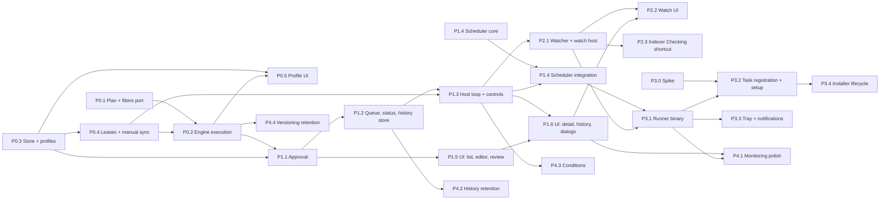

# Automation — Work packages

Requirements: [requirements.md](requirements.md) · Design: [design.md](design.md)

## How to use this file

- Each package is one branch and one pull request. Its **acceptance** list cites requirement IDs; the package is
  done when every cited ID has a passing test (named after the ID or referencing it in a comment) and the gates
  below are green.
- Do not make decisions the design already made. If something in the design is impossible or ambiguous, stop and
  report instead of improvising; open questions are in design §14.
- **Security review** is either **REQUIRED** (a dedicated security reviewer signs off before merge; the package
  report lists the threat-model rows of design §10.2 it touches and how each is tested) or **recommended**.
- Gates for every package (see `CONTRIBUTING.md`): `cargo fmt -- --check`, `cargo clippy --all-targets -- -D
warnings`, `cargo test` for touched crates, `npx prettier --check .`, `npm run lint`, `npx svelte-check
--threshold error`, `npx vitest run`; UI packages also run the relevant Playwright specs (mock IPC,
  `--workers=2`). Builds and test suites run one after another, not in parallel.
- Every new IPC command updates `docs/ipc.md`, its TS wrapper in `src/lib/ipc/` and a fixture in
  `contract-fixtures/automation/`.
- **Merge hotspots:** `src-tauri/src/lib.rs` (command registration, `setup`), `src-tauri/Cargo.toml` /
  `Cargo.lock`, `src-tauri/src/compare.rs`, `src/lib/components/Sidebar.svelte`,
  `src/lib/components/SettingsDialog.svelte`, `docs/ipc.md`. Edits there are append-only blocks; packages that
  run in parallel rebase on each other and resolve these by keeping both blocks.

Size legend (including tests): **S** ≤ 1 day / ≤ 400 lines · **M** 2–4 days / ≤ 1 200 lines · **L** 1–2 weeks /
≤ 3 000 lines · **XL** would be > 2 weeks and is split before starting (none below).

## Order and why it differs from the first sketch

The initial sketch was: P0 Sync Profile → P1 Watch → P2 Schedule → P3 Background runner → P4 Monitoring/history
and Pause/Stop UI. This plan keeps the five phases but changes three things:

1. **Schedule comes before Watch** (P1 = automation core + schedule, P2 = watch). The schedule trigger is pure
   and deterministic (time arithmetic with a fake clock), so it exercises the whole new pipeline — approval, queue,
   gate, lease, engine, history, status — with almost no new OS surface. Watch adds the riskiest OS behaviour
   (recursive notifications, overflow, device arrival). Building it on a pipeline that is already proven keeps
   failures attributable.
2. **Minimum monitoring moves into P1.** No automation may run unattended without Stop, Pause (finish / stop),
   run history and the Needs attention → Recheck → Retry loop (RQ-8, RQ-9, RQ-10). Those are safety controls, not
   polish. P4 keeps the richer monitoring (filters, cards, badges, paging, live cross-process updates) and the
   optional features.
3. **A small spike for the background runner (P3.0) starts on day one**, in parallel with P0, because the whole
   P3 depends on one OS assumption (a per-user logon task can be registered without admin, design §12.2, Q1). If
   the spike fails, the fallback decision is needed long before P3.

## Dependency graph

## Parallel waves

Packages in the same wave touch disjoint files except the hotspots listed above.

| Wave | Packages                                             | Notes                                                                                                                                                                                                                                    |
| ---- | ---------------------------------------------------- | ---------------------------------------------------------------------------------------------------------------------------------------------------------------------------------------------------------------------------------------- |
| 1    | P0.1 · P0.3 · P3.0 · P1.4 (core only)                | P0.1 = `sync_engine/{plan,settle,filters}.rs` + `compare.rs`; P0.3 = `automation/store`, `sync_engine/roots.rs`, `native_dialog.rs`, `hotlist/mod.rs`; P3.0 = throwaway spike outside `src/`; P1.4 core = `automation/scheduler.rs` only |
| 2    | P0.4 · P0.5 (against mocked IPC)                     | P0.5 finishes after P0.2 lands (preview/run)                                                                                                                                                                                             |
| 3    | P0.2                                                 | Needs P0.1 and P0.4                                                                                                                                                                                                                      |
| 4    | P1.1 · P1.5 (mocked IPC from P1.1's fixtures)        |                                                                                                                                                                                                                                          |
| 5    | P1.2 · P1.6 (mocked)                                 |                                                                                                                                                                                                                                          |
| 6    | P1.3 then P1.4 (integration)                         | P1.3 owns `automation/host.rs`                                                                                                                                                                                                           |
| 7    | P2.1 · P3.3 (tray/notify module against a fake host) | P2.1 owns watch hooks in `host.rs`                                                                                                                                                                                                       |
| 8    | P2.2 · P2.3 · P3.1                                   | P3.1 must not edit `host.rs` beyond constructing `HostClass::Background`                                                                                                                                                                 |
| 9    | P3.2 · P4.1 · P4.2                                   |                                                                                                                                                                                                                                          |
| 10   | P3.4 · P4.3 · P4.4                                   |                                                                                                                                                                                                                                          |

---

## P0 — Sync Profile (prerequisite)

### P0.1 Plan, settle and filters in Rust

- **Goal:** a Rust implementation of today's TypeScript plan classification and baseline reconciliation, proven
  identical by shared fixtures, plus profile filters in the compare walker.
- **Files:** new `src-tauri/src/sync_engine/{mod.rs,plan.rs,settle.rs,filters.rs}`; `src-tauri/src/compare.rs`
  (`compare_dirs_filtered`, `EntryFilter`, cap parameter — existing behaviour unchanged); new
  `contract-fixtures/sync-plan/*.json`, `contract-fixtures/sync-baseline/*.json`; new
  `src/lib/syncPlan.fixtures.test.ts`, `src/lib/syncBaseline.fixtures.test.ts`.
- **Depends on:** nothing.
- **Acceptance:** SP-2.1, SP-2.2, SP-2.3, SP-4.1, SP-4.2, SP-4.3, SP-4.4; design §5.2, §5.3.
- **Required tests:**
  - Fixture parity: the same fixtures pass in vitest (TS) and `cargo test` (Rust); at least one fixture per
    `SyncAction`, per `SyncConflictReason`, folder entries, case collision, untrusted and swapped baseline,
    blockers (truncated / cancelled / errors), stale detection by size, mtime and content verdict.
  - SP-2.3 only with `propagate_deletes = true`: deleted-left-unchanged-right → `deleteRight`; modified on the
    other side → conflict `modifyDelete`; no trusted baseline → conflict.
  - Filters: `*`, `?`, `**`, trailing `\`, case-insensitive (incl. non-ASCII), include + exclude interplay; an
    excluded target file is never planned for delete in mirror mode; excluded folder not descended (walker count).
  - Built-in excludes: staging and backup names from `copy_engine`, `$RECYCLE.BIN`, `System Volume Information`.
  - `compare_dirs` (unfiltered) output unchanged for the existing compare test suite.
  - Cap: 200 001 synthetic entries → blocker with the SP text (use the walker's in-memory `TreeSource`).
- **Security notes:** classification decides deletes. Review focus: no path where a filter, a missing baseline or
  a folder/file mismatch turns into a delete.
- **Security review:** REQUIRED.
- **Size:** L.

### P0.2 Engine execution and delete policies

- **Goal:** `sync_engine::run` executes a plan with per-operation status, Recycle Bin / versioning / permanent
  delete policies, guards, retries, cancel, just-in-time checks and lease-guarded settle; manual profile preview
  and run commands.
- **Files:** new `src-tauri/src/sync_engine/{execute.rs,delete_policy.rs,versioning.rs,errors.rs}`;
  `sync_engine/mod.rs`; `automation/commands.rs` (`sync_profile_preview`, `sync_profile_run`); `docs/ipc.md`;
  `src/lib/ipc/syncProfiles.ts` (two wrappers).
- **Depends on:** P0.1, P0.3 (profile model), P0.4 (lease guard type).
- **Acceptance:** SP-3.1, SP-3.2, SP-3.4, SP-5.1, SP-5.2, RQ-1, RQ-7.1–RQ-7.5, RQ-8.1 (engine part), RQ-9 (engine
  outcomes), IX-1 (engine path), SE-9; design §5.4–§5.7.
- **Required tests:**
  - Temp-tree runs for each mode × each delete policy; resulting trees asserted file by file.
  - Versioning layout `<root>\Right\<stamp> #<run>\<rel>` for deletes and overwrites; same-volume rename and
    cross-volume copy+delete paths (cross-volume simulated through an injected mover when only one volume exists).
  - A junction planted inside the versioning tree (between plan and move) is rejected and nothing is written through
    it (test skips with a message when junction creation is not permitted).
  - Recycle Bin refused on a non-fixed drive (injected `DriveType`), at save and at run time.
  - Guard: 51 deletes of 100 entries → Failed before any op; empty source with target entries → Failed.
  - JIT: source modified between plan and op → op `changed`, run continues, pending flag reported.
  - Errors: scripted sharing violation retried 2× then succeeds; access denied stops the run (remaining
    `notStarted`, outcome Partial); root vanished mid-run → Interrupted; per-item invalid name → op failed, run
    continues.
  - Cancel mid-run: file in progress either complete or absent (no `.ferrum-stage-` leftover); outcome Cancelled.
  - Settle saves the baseline only while the lease guard is alive; without it, `save` is refused.
  - Indexer path: with a fake `ChangesSource` answering `complete`, content reads are skipped exactly as
    `sync_incremental` tests specify; with `rescan`, all content is read.
- **Security notes:** first code that deletes and moves user files unattended. Versioning moves must use the
  no-follow primitives; `remove_dir_all` must not follow junctions; error texts must not leak into IPC with paths
  except the documented run error text stored in history.
- **Security review:** REQUIRED.
- **Size:** L.

### P0.3 Store foundation and profiles

- **Goal:** the SQLite automation store (schema v1, migration framework), the Sync Profile model with validation,
  root canonicalization and identity, readiness, revisions, profile commands, and the shared native confirmation.
- **Files:** new `src-tauri/src/automation/{mod.rs,model.rs,confirm_text.rs,commands.rs}`,
  `automation/store/{mod.rs,migrate.rs,profiles.rs,hosts.rs}`, `src-tauri/src/sync_engine/roots.rs`, new
  `src-tauri/src/native_dialog.rs`; `src-tauri/src/hotlist/mod.rs` (call `native_dialog::confirm`, no behaviour
  change); `src-tauri/src/profile.rs` (`local_data_dir`, `resolve_local_data_dir`); `src-tauri/src/lib.rs`
  (register commands, manage state); `src-tauri/Cargo.toml` (`rusqlite`); `src/lib/ipc/syncProfiles.ts` (+ test);
  `docs/ipc.md`.
- **Depends on:** nothing.
- **Acceptance:** SP-1.3, SP-1.4, SP-1.5, SP-3.3, SP-5.1 (guard-off confirm), SP-6.1, SP-6.2, SP-6.3, SP-6.4 (store
  side; automations table arrives in P1.1 — implement the hook and test it there), SP-7.1, SP-7.2, SP-7.3, SP-8,
  SP-9.5, SE-1 (profile part), SE-2, SE-5, SE-7, LC-3, LC-5; design §4, §5.8, §7.1, §10.3.
- **Required tests:**
  - Migration v0→v1 on an empty dir; reopening is a no-op; a store with `user_version` higher than compiled →
    read-only, every write command returns `store_read_only`.
  - Backup file exists during a failing migration (injected failure) and the original is intact afterwards.
  - `automation` dir or `automation.db` as a junction/symlink → `store_untrusted`.
  - Profile validation table test: every rejected path form of SP-1.4, nested/same roots (incl. differing case and
    a junction alias), name rules, filter limits, guard ranges.
  - Revision bumps only on policy fields; rename keeps the revision; `expectedRevision` mismatch → `stale`.
  - `profile_revisions` changes list shows from → to display values; pruned to 50.
  - Identity: recorded on save; a different folder at the same path (delete + recreate) → readiness Not ready
    (identity mismatch).
  - Native confirm injected: permanent policy save with `false` → nothing stored; with `true` → stored; non-permanent
    saves never call the confirm; no command input field named or behaving like `confirmed`.
  - Hotlist tests unchanged and green after the extraction.
  - `profile::resolve_local_data_dir()` equals the Tauri-resolved local data dir (unit test with a fake known-folder
    provider) and honours `FERRUM_PROFILE_DIR`.
  - Grep test: no `tauri::` in `sync_engine/**` or `automation/**` except `automation/commands.rs`.
- **Security notes:** storage location, reparse-point refusal, native confirm extraction, IPC validation.
- **Security review:** REQUIRED.
- **Size:** L.

### P0.4 Root leases and manual sync integration

- **Goal:** cross-process leases on root sets; manual Synchronize Dirs acquires one; baseline saves require one.
- **Files:** new `automation/store/leases.rs`; `src-tauri/src/sync_baseline.rs` (lease check);
  `automation/commands.rs` (`sync_lease_acquire`, `sync_lease_release`); `src/lib/syncService.ts`,
  `src/lib/stores/syncFlow.svelte.ts` (+ tests), `src/lib/components/SyncPanel.svelte` (busy message);
  `docs/ipc.md`.
- **Depends on:** P0.3.
- **Acceptance:** RQ-2, design §3.4, §5.7, LC-6 (lease part).
- **Required tests:**
  - Overlap matrix: equal, nested both ways, `data` vs `data-backup` (not nested), case-insensitive, mapped drive
    vs its UNC (injected resolver), versioning root counted.
  - Two connections in two threads: second acquire on overlapping roots refused, disjoint roots allowed.
  - Dead holder (fake process probe) and stale heartbeat (> 30 s, fake clock) are reclaimed.
  - `sync_baseline_save` without a lease → `lease_required`; with a manual lease → saved.
  - vitest: `executeSync` acquires before re-validation and releases after settle, on cancel, on error and on
    close; busy lease → no enqueue, message shown.
- **Security notes:** correctness of the only cross-process lock; denial of service by a stuck lease must expire.
- **Security review:** REQUIRED.
- **Size:** M.

### P0.5 Sync profiles UI

- **Goal:** "Sync & Backup" sidebar section, Sync profiles page, profile editor, preview and manual run.
- **Files:** new `src/lib/components/sync/{SyncProfilesPage.svelte,SyncProfileEditor.svelte,ProfilePicker.svelte}`
  (+ tests), `src/lib/stores/syncProfilesStore.svelte.ts` (+ test); `src/lib/components/Sidebar.svelte`;
  `src/lib/uiState.svelte.ts` (page routing); new `e2e/sync-profiles.e2e.ts`.
- **Depends on:** P0.3 (contract); P0.2 for preview/run (develop against mocks first).
- **Acceptance:** SP-1.1, SP-1.2, SP-2.4, SP-3.1 (message), SP-4.5, SP-6.2 (stale UX), SP-7.2 (identity UX), SP-8,
  SP-9.1–SP-9.5.
- **Required tests:**
  - vitest: editor validation mirrors backend errors; "Use current panes" fills roots; mode/side toggles; delete
    policy cards disable Recycle Bin with the reason; stale save reloads.
  - Playwright (mock IPC): create, edit (revision shown), delete refused when used, preview summary, run with
    overwrite confirmation; light and dark screenshots.
  - ProfilePicker renders Ready and Not-ready (disabled with reason) cards — reused by P1.5.
- **Security notes:** UI never sends display text for the native dialog; it only sends the draft.
- **Security review:** recommended.
- **Size:** L.

---

## P1 — Automation core and Schedule (in-app)

### P1.1 Automation model, approval and test run

- **Goal:** automations table (schema v2), policy hash, DPAPI-keyed MAC, test run ledger, native-confirmed approve
  and resume, pause/delete.
- **Files:** `automation/model.rs`; new `automation/{policy.rs,dpapi.rs}`, `automation/store/{automations.rs,
approvals.rs}`, `automation/store/migrate.rs` (v2); `automation/confirm_text.rs`; `automation/commands.rs`
  (`automation_validate`, `automation_test`, `automation_approve`, `automation_set_enabled`, `automation_pause`
  (config part), `automation_delete`); `src-tauri/Cargo.toml` (`hmac`, windows-sys `Win32_Security_Cryptography`);
  `src/lib/ipc/automation.ts` (+ test); `contract-fixtures/automation/`; `docs/ipc.md`.
- **Depends on:** P0.3; P0.2 (dry run for the test).
- **Acceptance:** AP-2.1 (validation), AP-2.4, AP-4.1, AP-4.2 (step results), AP-4.4, AP-5, AP-6, SE-1, SE-2,
  SE-2.1, SE-2.2, SE-3.1, SE-3.2, SE-5, SE-7, SP-6.4 (automations marked Needs review in the profile-save
  transaction), LC-5 (v1→v2); design §8, §10.3.
- **Required tests:**
  - Golden policy hash for a fixture policy; changing any field of `ProfilePolicy` or `AutomationPolicy` changes
    the hash; changing the automation name does not.
  - MAC verify: valid; tampered `policy_hash`; tampered `profile_revision`; key file deleted → every approval
    `keyUnavailable` → Needs review; key from another DPAPI scope (simulated by a different entropy) fails.
  - `approve_in` with injected confirm: no passed test → `stale`; test for another hash → `stale`; test older than
    15 min (fake clock) → `stale`; confirm `false` → `canceled` and nothing written; profile saved by another
    connection while the dialog is open → `stale`; happy path writes automation + approval + event atomically.
  - Resume: valid approval + confirm → enabled; profile changed → `needs_review` without showing the dialog.
  - Profile save with dependants → each dependant verifies as `profileChanged{from,to}` and gets the SP-6.4 event.
  - Prompt texts: warnings first, bounded to 2 000 chars, control characters removed, permanent warning present.
  - Migration v1→v2 fixture.
- **Security notes:** the core authorization path of the whole feature.
- **Security review:** REQUIRED.
- **Size:** L.

### P1.2 Queue, runtime state, status and history store

- **Goal:** store tables and pure logic for queue coalescing, runtime state, status precedence, runs, operations,
  events and controls, plus the read commands.
- **Files:** new `automation/store/{runtime.rs,queue.rs,runs.rs,events.rs,controls.rs}`, `automation/status.rs`;
  `automation/commands.rs` (`automation_list`, `automation_get`, `automation_history`, `automation_run_ops`,
  `automation_events`); `src/lib/ipc/automation.ts`; fixtures; `docs/ipc.md`.
- **Depends on:** P1.1.
- **Acceptance:** status inventory and precedence (requirements §1), RQ-3.1, RQ-3.4, RQ-9.1, RQ-9.2, MH-7, MH-8,
  OP-2 (attention run never pruned — the rule, not the retention feature); design §4.3, §9.1.
- **Required tests:**
  - Status precedence table test: one case per row of design §9.1 and every pairwise conflict in the precedence
    chain (e.g. review beats running; queued-device beats attention; attention beats paused).
  - Queue: second trigger for the same profile merges (count + reasons), different profile with overlapping roots
    queues separately, FIFO per host class, persists across reopen.
  - Runs: id never reused after delete; `run_ops` capped at 5 000 with totals intact; events pruned to 200 per
    automation; controls older than 10 min ignored.
  - Labels and sub-lines match the prototype strings listed in requirements §1/§7 (snapshot test of `StatusDto`).
- **Security notes:** none beyond input validation.
- **Security review:** recommended.
- **Size:** M.

### P1.3 Host loop and controls (in-app class)

- **Goal:** the shared `Host` (generic over `HostClass::{App, Background}`), in-app host election, gate, lease use,
  engine invocation, history recording, attention lifecycle, controls (run now, stop, pause finish/stop, recheck,
  retry), progress and change events.
- **Files:** new `automation/host.rs`, `automation/store/hosts.rs` (election), `automation/commands.rs`
  (`automation_run_now`, `automation_stop_run`, `automation_pause` (run part), `automation_recheck`,
  `automation_retry`; events `automation://changed`, `automation://progress`); `src-tauri/src/lib.rs` (start the
  in-app host in `setup`).
- **Depends on:** P1.2, P0.2, P0.4.
- **Acceptance:** RT-4, RQ-1, RQ-2, RQ-3.2, RQ-3.3, RQ-4, RQ-5 (data), RQ-6, RQ-8.1, RQ-8.2, RQ-9, RQ-10.1–RQ-10.5,
  SE-4, LC-6, MH-10 (signals and `change_seq`); design §3, §10.4.
- **Required tests (FakeDeps + virtual time):**
  - Gate: each refusal reason of design §10.4 produces no engine call, the right status and one event.
  - Prototype flows: Run now toasts (queued / waiting / merged / device); partial → Needs attention → new triggers
    held → Recheck (remaining 2) → Retry → completed → "Resolved by run #n"; conflict → recheck before/after
    resolving in Sync; Stop mid-run → Cancelled with the no-rollback note; Pause & let it finish vs Pause & stop.
  - Two app instances (two `Host` objects on one store): only one hosts; killing the host (drop without release,
    fake clock + 15 s) hands over.
  - Crash recovery: a run row left `Running` by a dead host becomes Interrupted at next start; its lease expires.
  - `HostClass::Background` constructed in a test executes only background automations (the runner in P3.1 only
    wires it up).
- **Security notes:** the gate is the last line before file operations; every run path must go through it
  (retries, catch-ups, pending reruns) — test that no code path calls the engine without a `GateOk`.
- **Security review:** REQUIRED.
- **Size:** L.

### P1.4 Scheduler

- **Goal:** schedule occurrences with IANA zones and DST rules, missed-run detection and policies, timer, power and
  clock events for the app host.
- **Files:** new `automation/scheduler.rs` (core, wave 1), `automation/power.rs` (hidden message window for the
  app host); `automation/host.rs` (schedule hook, after P1.3); `src-tauri/Cargo.toml` (`jiff`, windows-sys
  `Win32_System_Power`).
- **Depends on:** core: nothing; integration: P1.3.
- **Acceptance:** SC-1.1, SC-1.2 (data), SC-1.3, SC-2.1, SC-2.2, SC-2.3 (text), SC-3.1–SC-3.4, SC-4; design §9.3.
- **Required tests (fake clock):**
  - Next three occurrences for once/daily/weekly incl. week wrap; "already passed" validation.
  - `Europe/Amsterdam` spring-forward 02:30 → skipped with the SC-2.1 entry; autumn fold 02:30 → one run at the
    first instant; `America/New_York` likewise; `Asia/Jakarta` no DST.
  - Missed: host down 3 occurrences → Skip writes one aggregated Skipped entry; RunOnce adds exactly one catch-up;
    fired 119 s late = on time, 121 s late = missed.
  - Clock moved back 2 h after firing → no second fire; zone change → recompute.
  - Device offline at fire time → queued and held, starts on reconnect (fake volume probe).
- **Security notes:** none.
- **Security review:** recommended.
- **Size:** M.

### P1.5 UI: StatusChip, list, editor (schedule), review & approve

- **Goal:** the Automation page list, the editor for scheduled automations (profile picker, schedule fields,
  runtime chooser with Background shown Unavailable/Needs setup until P3.2), review and approval screens.
- **Files:** new `src/lib/components/automation/{StatusChip.svelte,AutomationPage.svelte,AutomationList.svelte,
AutomationEditor.svelte,AutomationReview.svelte}` (+ tests), `src/lib/stores/automationStore.svelte.ts` (+ test);
  `Sidebar.svelte` (Automation entry); new `e2e/automation-schedule.e2e.ts`.
- **Depends on:** P1.1 contract (mock first), P0.5 (`ProfilePicker`).
- **Acceptance:** requirements §1 (StatusChip: 18 kinds with icon + label), MH-1, MH-2, MH-3 (basic), MH-4
  (basic), AP-1, AP-2.1–AP-2.4, AP-3, AP-4.1–AP-4.4 (UI), AP-5 (UI), AP-6 (UI), RT-1, RT-1.1, RT-1.2, SC-1.1, SC-1.2,
  SC-2.3, RQ-4 (toasts).
- **Required tests:**
  - StatusChip renders every kind with icon, label and tint, in light and dark.
  - Editor: validation messages exactly as specified; next 3 runs and zone equivalence line; "Continue to review"
    disabled with errors; Background card disabled with the RT-1.1 reason.
  - Review: approve disabled until a passed test; failed step text shown; approve sends only `{draft, testId}`;
    `canceled` result keeps the user on review; `stale` shows "The profile or automation changed — review again".
  - Playwright: new scheduled automation end-to-end against mock IPC; re-review after profile change shows the
    from → to list.
- **Security notes:** no client-side "approved" state is ever sent; the button only triggers the backend flow.
- **Security review:** recommended.
- **Size:** L.

### P1.6 UI: detail, run progress, history, Pause/Stop dialogs

- **Goal:** detail page for scheduled automations, current run progress, recent runs, events, run history with
  Recheck/Retry/Review in Sync, Pause and Stop dialogs.
- **Files:** new `src/lib/components/automation/{AutomationDetail.svelte,RunHistory.svelte,PauseStopDialog.svelte}`
  (+ tests); `automationStore.svelte.ts`; `e2e/automation-history.e2e.ts`.
- **Depends on:** P1.5; P1.3 contract (mock first).
- **Acceptance:** MH-5 (schedule pipeline), MH-6, MH-7 (UI), RQ-5, RQ-6 (UI), RQ-8.1, RQ-8.2, RQ-10.1–RQ-10.5 (UI).
- **Required tests:**
  - Pause dialog: three buttons, default "Pause & let it finish", sends `automation_pause{mode}`; Stop dialog with
    the no-rollback note.
  - History: filter All / Needs attention; expanding shows ops, error, note; Retry only after a recheck with
    remaining > 0 and never for conflicts; "Review in Sync ↗" opens Synchronize Dirs pinned to the profile roots.
  - Progress: phase texts, bar, counts, op list paging at 200.
  - Playwright: partial run → resolve loop with mock IPC.
- **Security notes:** none.
- **Security review:** recommended.
- **Size:** L.

---

## P2 — Watch folders (in-app)

### P2.1 Watcher and watch host

- **Goal:** recursive change notifications per watched root, the watch state machine (quiet countdown, max wait,
  pending rerun, checking, device, recheck, unsupported), self-change suppression, startup/resume Checking.
- **Files:** new `automation/watcher.rs`; `automation/host.rs` (watch hooks); `automation/power.rs` (volume
  arrival/removal); `automation/status.rs` (watch sub-lines if missing); `automation/commands.rs` (watch fields in
  validate/test).
- **Depends on:** P1.3.
- **Acceptance:** WA-1.1–WA-1.4, WA-2.1, WA-2.3, WA-2.5, WA-3.1–WA-3.4, WA-4.1, WA-4.2, WA-5.1–WA-5.3, WA-6,
  WA-7.1, WA-7.2, AP-4.1 (notification step); design §9.2.
- **Required tests (fake watcher + virtual time):**
  - Prototype fixture: events at t=0 and t=6, idle 10 → exactly one run queued at t=16.
  - Max wait: events every 5 s with idle 10 for 15 min → one run at 15 min.
  - Events during a run → one pending rerun, merged messages; after the run → recompare; recompare in sync → no
    run and the "Ignored N changes … (self-generated)" event.
  - Overflow (`notify` rescan flag) → Needs recheck → full comparison only after the overlapping run ends.
  - Root removed → Waiting for device (no compare, no run); returned with/without "Location becomes available".
  - Events on excluded and staging paths ignored.
  - Network root → `unsupported`; no timer-based polling exists (assert the fake watcher factory is the only
    source of change events; the UNC availability probe never lists directories).
  - Real `notify` smoke test on a temp dir: nested file change delivers an event (recursive).
- **Security notes:** event paths are untrusted strings; never used to build operations (the engine compares).
- **Security review:** recommended.
- **Size:** L.

### P2.2 Watch UI

- **Goal:** watch fields in the editor, countdown preview, watch pipeline and quiet bar on the detail page, watch
  events.
- **Files:** `AutomationEditor.svelte`, `AutomationDetail.svelte`, `AutomationReview.svelte`,
  `automationStore.svelte.ts` (+ tests); new `e2e/automation-watch.e2e.ts`.
- **Depends on:** P2.1 contract, P1.6.
- **Acceptance:** WA-1.2, WA-1.3, WA-2.1, WA-2.2, WA-2.3 (UI text), WA-2.4, WA-8, MH-5 (watch pipeline), AP-3 (watch
  policies).
- **Required tests:** idle stepper clamps 2–3600; unsupported root checkbox disabled with its note; "Simulate a
  change" countdown resets and ends with the preview text and never calls IPC; Playwright watch flow with mock
  events.
- **Security notes:** none.
- **Security review:** not needed.
- **Size:** M.

### P2.3 Indexer Checking shortcut (SHOULD)

- **Goal:** Checking completes without walking when the FerrumIndexer journal proves both roots unchanged since the
  last fully verified run.
- **Files:** `automation/host.rs` (checking path) or a new `automation/journal_check.rs`; reuse
  `sync_incremental.rs`.
- **Depends on:** P2.1.
- **Acceptance:** WA-7.3, IX-1, IX-2; design §11.
- **Required tests:** fake `changes` answers: `complete` with no dirs under roots → shortcut; a changed dir under a
  root, `rescan:*`, marks older than 7 days, pref off, UNC root → ordinary comparison.
- **Security notes:** a wrong "no changes" only delays a sync (never deletes); keep the same mark rules as FER-477.
- **Security review:** recommended.
- **Size:** M.

---

## P3 — Background runner, tray and notifications

### P3.0 Spike: per-user logon task without admin (throwaway)

- **Goal:** prove on Windows 10 22H2 and Windows 11 as a **standard user**: (1) registering a task with a
  `LogonTrigger` for the current user, `InteractiveToken`, `LeastPrivilege` succeeds without UAC via the COM API
  and via `schtasks /Create /XML`; (2) the task starts at the next sign-in; (3) a balloon from `Shell_NotifyIconW`
  shows as a toast in the notification center and its click arrives as `NIN_BALLOONUSERCLICK`;
  (4) `taskkill /IM` (no `/F`) from an elevated prompt delivers `WM_CLOSE` to the runner's hidden window in another
  session or not.
- **Files:** none in `src/` or `src-tauri/src/`; a short findings section appended to design §12 in the P3.2 PR.
- **Depends on:** nothing.
- **Acceptance:** written findings with OS build numbers; decision input for Q1.
- **Required tests:** n/a (manual, documented).
- **Security review:** not needed.
- **Size:** S.

### P3.1 Runner binary and background host

- **Goal:** `ferrum-automation.exe` running the shared host as `Background`, single instance, heartbeat, store
  signals, idle exit, shutdown handling, version skew, crash recovery.
- **Files:** new `src-tauri/src/bin/ferrum-automation.rs`, `automation/runner/{mod.rs,cli.rs,main_loop.rs}`;
  `automation/power.rs` (session end, `TaskbarCreated` hook points); `src-tauri/build.rs` (link flags like the
  helper if needed); `src-tauri/Cargo.toml` (`[[bin]]` if required); new
  `src-tauri/tests/automation_runner.rs`.
- **Depends on:** P1.3, P1.4, P2.1.
- **Acceptance:** RT-3.1–RT-3.5, RT-3.6 (runner side), SE-6, SE-8, LC-2 (runner side), LC-3, LC-4 (runner side),
  LC-6, LC-7, T11, T13, T14 of design §10.2; design §12.1, §12.4.
- **Required tests:**
  - CLI: every accepted form; unknown flag, extra argument, relative `--profile-dir`, UNC `--profile-dir` → exit 2
    before the store is opened.
  - Process test: spawn `--console --profile-dir <tmp>`; insert a background automation + approval via the store
    test helpers; touch files → run recorded; an in-app automation in the same store is never executed by the
    runner.
  - Second runner on the same profile dir exits 0 immediately; runner on a different profile dir runs.
  - Kill the runner mid-run (`TerminateProcess`) → restart marks the run Interrupted, the lease expires, no staged
    file remains published.
  - Store `user_version` above the runner's → exit 5, nothing written.
  - `restartRunner` control → exits when idle; not during a run.
  - Idle exit after 10 min (fake clock in console mode via a test-only `--fake-clock` **compiled only with
    `cfg(test)` or a `test-support` feature**, never in release).
  - The runner opens no pipe and registers no window class that accepts `WM_COPYDATA` (code inspection test + a
    test that sending `WM_COPYDATA` to its hidden window is ignored).
- **Security notes:** new long-running process with no UI; argv and environment are attack surface; DLL search
  hardening first.
- **Security review:** REQUIRED.
- **Size:** L.

### P3.2 Task registration, capability, setup and Settings

- **Goal:** register / probe / remove the per-user logon task, start the runner from the app, runtime chooser and
  Settings section become live.
- **Files:** new `automation/runtime/{mod.rs,task_scheduler.rs,capability.rs,launcher.rs}`;
  `automation/commands.rs` (`automation_runtime_status`, `automation_runtime_setup`, `automation_runtime_remove`);
  new `src/lib/components/AutomationSettingsSection.svelte` (+ test); `SettingsDialog.svelte`;
  `AutomationEditor.svelte` (runtime card live); `src-tauri/Cargo.toml` (COM crate if chosen, design §6.2);
  `docs/ipc.md`; design §12 (spike findings).
- **Depends on:** P3.0, P3.1.
- **Acceptance:** RT-1.1, RT-2.1–RT-2.4, RT-3.6 (app side), LC-4 (app side), SE-1 (setup), SE-8; design §12.2.
- **Required tests:**
  - `TaskSpec` → XML (or COM property) golden test: principal, trigger, settings, action exactly as design §12.2.
  - Capability: fake registrar returns missing / disabled / other path / other user / ok → Needs setup ×4 / Ready;
    runner binary missing → Unavailable.
  - Setup with injected confirm false → nothing registered; true → registered then launcher called; registrar
    error → `register_failed`, capability unchanged.
  - Remove → task removed, runner asked to quit, background automations paused with the RT-2.4 event.
  - App start with background automations enabled and no live runner → launcher called once.
  - `#[ignore]` real registration test as a standard user under a unique task name (register, query, remove).
- **Security notes:** creates a persistent auto-start entry for the user; must never request elevation or create a
  task for another user; action path must be the runner next to the running app.
- **Security review:** REQUIRED.
- **Size:** M.

### P3.3 Tray icon and notifications

- **Goal:** runner tray icon with states and menu; Windows notifications for Partial, Failed, Conflict held and
  Needs review; click opens Ferrum.
- **Files:** new `automation/runner/{tray.rs,notify.rs}`; `src-tauri/src/lib.rs` (parse `--open-automation <id>`
  strictly at app start, route to the detail page); `src/lib/uiState.svelte.ts` (initial route).
- **Depends on:** P3.1 (can develop against a fake host in wave 7).
- **Acceptance:** NT-1–NT-5, T15 of design §10.2.
- **Required tests:**
  - Notification policy table: outcome kinds × rate limit window (fake clock) → shown / suppressed.
  - Text builder: names with control characters, 10 000-character names, paths → bounded, sanitized.
  - Tray state from host snapshot (idle / running / attention) and tooltip text.
  - App argv: `--open-automation <uuid>` accepted; anything else ignored (no navigation, logged once).
- **Security notes:** launches `ferrum.exe` from the runner's own directory only, with a validated UUID argument.
- **Security review:** REQUIRED.
- **Size:** M.

### P3.4 Installer lifecycle

- **Goal:** installers stop runners before replacing files, delete all users' runner tasks on uninstall, optional
  data purge; runner self-unregisters when Ferrum is gone.
- **Files:** `src-tauri/windows/installer-hooks.nsh`; new `src-tauri/windows/automation-runner.wxs`;
  `src-tauri/tauri.conf.json` (`fragmentPaths`, `componentGroupRefs`); `automation/runner/main_loop.rs`
  (self-check); docs: `docs/specs/automation/design.md` §12.3 if details change.
- **Depends on:** P3.2.
- **Acceptance:** LC-1, LC-2 (installer side), LC-4, SE-8; design §12.3.
- **Required tests:**
  - Self-check unit test: runner directory without `ferrum.exe` → unregister called (fake registrar) and exit.
  - NSIS/WiX: static checks that every executed program is under `$SYSDIR` / `[SystemFolder]` (grep test like the
    indexer hooks), that failures do not abort, and that the uninstall step targets only tasks named
    `Ferrum Automation Runner (*`.
  - Manual verification list design §13.3 steps 7–8 recorded in the PR with OS builds.
- **Security notes:** elevated installer code; only System32 binaries; never execute from the install folder.
- **Security review:** REQUIRED.
- **Size:** M.

---

## P4 — Monitoring polish and optional features

### P4.1 Monitoring polish

- **Goal:** complete the monitoring experience across processes: attention cards in history, sidebar badge, queue
  strip with merge counts and reasons, live updates within 2 s from the runner, paging of events and operations,
  runtime state chip in rows.
- **Files:** automation UI components and store; `automation/commands.rs` (paging params if missing).
- **Depends on:** P1.6, P3.1.
- **Acceptance:** MH-1 (badge text), MH-3, MH-4, MH-6 (attention cards), MH-9, MH-10, RT-1.2 (runner-not-running
  note).
- **Required tests:** vitest for badge counts and card texts; Playwright: a background run's progress appears in
  the detail page from store polling (mock), attention card → filtered history.
- **Security review:** not needed.
- **Size:** M.

### P4.2 History retention (optional, OP-2)

- **Files:** `automation/store/runs.rs`, `events.rs` (pruning), `AutomationSettingsSection.svelte`.
- **Depends on:** P1.2.
- **Acceptance:** OP-2.
- **Required tests:** pruning by age and count; attention run kept; settings round-trip.
- **Security review:** not needed. **Size:** S.

### P4.3 Conditions: battery and metered (optional, OP-1)

- **Files:** `automation/power.rs` (AC status, metered probe), `automation/host.rs` (gate step 6), editor
  advanced section.
- **Depends on:** P1.3.
- **Acceptance:** OP-1.
- **Required tests:** fake power probe: on battery → queued with "Waits for AC power" → AC returns → runs; metered
  applies only when a root is a network path.
- **Security notes:** metered detection needs COM (`INetworkCostManager`); if the COM crate is not already present
  from P3.2, add it only in this module.
- **Security review:** recommended. **Size:** M.

### P4.4 Versioning retention (optional, OP-3)

- **Files:** new `sync_engine/versioning_retention.rs`, profile editor field.
- **Depends on:** P0.2.
- **Acceptance:** OP-3.
- **Required tests:** deletes only stamp folders older than N days directly under `<root>\Left|Right\`; never
  follows junctions; never touches anything else under the versioning root.
- **Security notes:** permanent deletion of user data by policy.
- **Security review:** REQUIRED. **Size:** M.

---

## Summary

| Package                          | Size | Security review | Wave         |
| -------------------------------- | ---- | --------------- | ------------ |
| P0.1 Plan, settle, filters       | L    | REQUIRED        | 1            |
| P0.2 Engine execution            | L    | REQUIRED        | 3            |
| P0.3 Store + profiles            | L    | REQUIRED        | 1            |
| P0.4 Leases + manual sync        | M    | REQUIRED        | 2            |
| P0.5 Profile UI                  | L    | recommended     | 2            |
| P1.1 Approval + test run         | L    | REQUIRED        | 4            |
| P1.2 Queue/status/history store  | M    | recommended     | 5            |
| P1.3 Host loop + controls        | L    | REQUIRED        | 6            |
| P1.4 Scheduler                   | M    | recommended     | 1 (core) / 6 |
| P1.5 UI list/editor/review       | L    | recommended     | 4            |
| P1.6 UI detail/history/dialogs   | L    | recommended     | 5            |
| P2.1 Watcher + watch host        | L    | recommended     | 7            |
| P2.2 Watch UI                    | M    | —               | 8            |
| P2.3 Indexer shortcut (SHOULD)   | M    | recommended     | 8            |
| P3.0 Spike                       | S    | —               | 1            |
| P3.1 Runner binary               | L    | REQUIRED        | 8            |
| P3.2 Task registration + setup   | M    | REQUIRED        | 9            |
| P3.3 Tray + notifications        | M    | REQUIRED        | 7            |
| P3.4 Installer lifecycle         | M    | REQUIRED        | 10           |
| P4.1 Monitoring polish           | M    | —               | 9            |
| P4.2 History retention (opt.)    | S    | —               | 9            |
| P4.3 Conditions (opt.)           | M    | recommended     | 10           |
| P4.4 Versioning retention (opt.) | M    | REQUIRED        | 10           |
